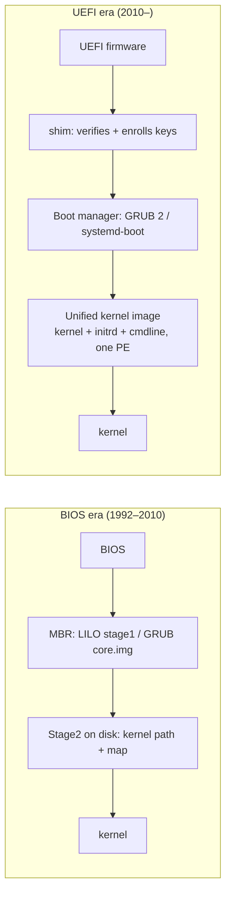

# A History of Linux Bootloaders

A bootloader is the first code the hardware runs beyond firmware. On x86 it historically lived in
the Master Boot Record (first 512 bytes of a disk); since the 2010s it is more commonly an EFI
application stored on the EFI System Partition. This document traces the Linux side of that
evolution, x86-centric, with the architecture-specific and embedded loaders that fill the gaps.

Dates are taken from primary sources (project sites, release notes, kernel and GNU docs) where
possible; items marked * are cross-checks and slightly less certain.

## Timeline at a glance

| Year | Loader | Who | Milestone |
|---|---|---|---|
| 1991–92 | — | — | Kernels booted raw from floppy; DOS machines dual-booted via DOS |
| 1992 | **LILO** | Werner Almesberger | First real Linux bootloader (first release June 1992) |
| early 1990s | **LOADLIN** | Hans Lermen | Boots Linux from MS-DOS |
| 1994 | **SYSLINUX** | H. Peter Anvin | Boots from FAT; family grows into a fleet |
| 1995 | **GRUB** | Erich Boleyn | Born booting GNU Hurd; Multiboot spec designed with Brian Ford |
| 1995–96 | **MILO** | DEC Alpha community | Firmware/boot loader for Alpha AXP Linux |
| ~1997 | **yaboot** | Chris Collins | PowerPC, Open Firmware (New World Macs, IBM) |
| 1999 | **GRUB → GNU** | Matzigkeit, Okuji | Official GNU package |
| 1999 | **PPCBoot** (→ Das U-Boot) | Wolfgang Denk | PowerPC embedded; becomes the embedded standard |
| ~2001 | **elilo** | Intel/community | EFI loader for Itanium and x86_64 UEFI |
| ~2001 | **SILO** | SPARC community | SPARC Linux loader |
| 2002 | **PUPA → GRUB 2** | Yoshinori Okuji | Ground-up rewrite of GRUB's core |
| 2002 | **ISOLINUX / PXELINUX** | H. Peter Anvin | CD-ROM and PXE network boot |
| 2002 | **kexec proposed** | Eric W. Biederman | Boot-from-the-kernel system call; merged in 2.6.13 (2005) |
| 2005 | **GRUB Legacy 0.97** | — | Last legacy release |
| 2005 | **EXTLINUX** (syslinux 3.00) | H. Peter Anvin | Boots from ext2/ext3 |
| 2005 | **kboot** | Werner Almesberger | First kexec-based bootloader (LILO's author again) |
| 2006–07 | **petitboot** | Ben Herrenschmidt, Geoff Levand | kexec-based loader, working on PS3 by April 2007; later standard on POWER/OpenPOWER |
| 2007 | **barebox** | Sascha Hauer (Pengutronix) | GPLv2 U-Boot fork |
| 2009 | GRUB 2 becomes Ubuntu default | — | Ubuntu 9.10 "Karmic" (first distro of the wave) |
| 2011 | GRUB 2 becomes Fedora default (F16) and Debian default (Squeeze) | — | Mainstream migration completes |
| 2012 | **GRUB 2.00** | Vladimir Serbinenko | First stable GRUB 2 release (28 June 2012) |
| 2012 | **Kernel EFI stub** | Matt Fleming | bzImage booted directly by UEFI firmware (Linux 3.3) |
| 2012 | **gummiboot** | Kay Sievers, Harald Hoyer | Minimal UEFI boot manager, standalone project |
| 2012 | **shim** | Matthew Garrett | First-stage Secure Boot loader (repo Apr 2012); Fedora 18 first to ship it (2013) |
| 2013 | **Boot Loader Spec, kernel-install** | systemd (Kay Sievers) | kernel-install lands in systemd v198 |
| 2015 | **systemd-boot** | — | gummiboot merged into systemd (v221), renamed; systemd-stub EFI stub added |
| 2022 | **UKI / ukify** | systemd | Unified kernel images standardized (systemd v252, BLS Type #2) |

## Boot chains: then and now

## 1. Before bootloaders: floppies and DOS (1991–1994)

Linux 0.x was booted by copying the raw kernel image to the first sectors of a floppy, or by a
small DOS utility that loaded it. **LOADLIN**, written by Hans Lermen and first released in the
early 1990s, let users boot Linux from within MS-DOS — no repartitioning needed — and was the
practical path on DOS-dominated machines. (Wikipedia, *secondary*:
https://en.wikipedia.org/wiki/Loadlin)

## 2. LILO: the first real Linux bootloader (1992–2015)

**LILO** (LInux LOader) by Werner Almesberger appeared in mid-1992. Its design was a hardware
personality: a tiny stage-1 in the MBR loaded a stage-2 from known disk sectors, and the kernel
was located by raw sector addresses recorded by the `lilo` installer. Consequences:

- Kernel moves required re-running `/sbin/lilo` after edits to `/etc/lilo.conf` — no filesystem
  knowledge at boot time.
- The classic 1024-cylinder BIOS limit and `/boot` placement constraints were real pain points.
- It still booted fine under LinuxBIOS-era firmware and was the default on most distros through
  the 1990s.

LILO outlived expectations: 0.97-era versions were maintained by John Coffman and then Joachim
Wiedorn; the final release was **24.2 (22 Nov 2015)**, still packaged in Debian.
(Wikipedia, *secondary*: https://en.wikipedia.org/wiki/LILO_(bootloader) · Debian tracker:
https://tracker.debian.org/pkg/lilo)

## 3. GRUB: the grand unified bootloader (1995–)

**GRUB** started in 1995 as a response to a very specific problem: Erich Boleyn needed to boot the
GNU Hurd on the University of Utah's Mach 4 microkernel. With Brian Ford he designed the Multiboot
Specification, and GRUB became the reference implementation. In 1999 Gordon Matzigkeit and
Yoshinori K. Okuji made it an official GNU package.
(GNU GRUB manual history, primary: https://www.gnu.org/software/grub/manual/grub/html_node/History.html)

What made GRUB a break: it *reads the filesystem at boot*. No re-install after every kernel
upgrade, an interactive command line, a menu, filesystem and chainloading support, and a config
files (`menu.lst`). It displaced LILO as the Linux default in the early-to-mid 2000s.

### GRUB Legacy → GRUB 2

The original codebase ("GRUB Legacy") hit its last release, **0.97, in 2005**. Around 2002 Okuji
began **PUPA**, a rewrite of the core that grew into **GRUB 2**: modular (drivers loaded at
runtime), scripting language, themes, and support for LVM, RAID, btrfs, ZFS, and later UEFI and
Secure Boot via shim. It took a decade to reach 1.0: **GRUB 2.00 was released 28 June 2012**.
(same GNU history page · release announcement:
https://lists.gnu.org/archive/html/grub-devel/2012-06/msg00093.html)

Distro adoption of GRUB 2 ran 2009–2011: Ubuntu made it the default in 9.10 (2009,
https://wiki.ubuntu.com/FoundationsTeam/Specs/KarmicGrub2), Fedora in Fedora 16 (2011,
https://fedoraproject.org/wiki/Features/Grub2), and Debian in Squeeze (2011). It remains the
default bootloader of most desktop/server distributions today.

## 4. The SYSLINUX family (1994–)

**SYSLINUX** (H. Peter Anvin, 1994) was built for FAT filesystems — MS-DOS floppies and early
Windows partitions — reading the filesystem at boot, unlike LILO. (README, primary:
https://kernel.googlesource.com/pub/scm/boot/syslinux/syslinux/+/refs/tags/syslinux-6.04-pre1/README)

It then multiplied into a family, unified under one menu system:

- **ISOLINUX** (~2002): ISO 9660 CD-ROMs — how most Linux install/live ISO menus worked.
- **PXELINUX** (~2002): PXE network boot — the standard for diskless and datacenter provisioning.
- **EXTLINUX** (syslinux 3.00, 2005): ext2/ext3. (https://www.syslinux.org/wiki/index.php?title=ISOLINUX ·
  https://www.syslinux.org/wiki/index.php?title=PXELINUX · https://www.kernel.org/pub/linux/utils/boot/syslinux/3.xx/syslinux-3.00.lsm)

SYSLINUX never became a desktop default; it owned the niches: rescue disks, installers, embedded
and network boot.

## 5. EFI and UEFI: the firmware wars (2001–)

Intel's EFI system arrived with Itanium. **elilo** served as the EFI Linux loader for IA-64 and
early x86_64 UEFI (kernel UEFI doc mentions it: https://kernel.org/doc/Documentation/x86/x86_64/uefi.txt),
and remained niche until Apple's Intel Macs (2006) forced the ecosystem to care.

Three 2012-era events reset the field:

- **Kernel EFI stub** (Matt Fleming, merged in Linux 3.3): `CONFIG_EFI_STUB` turns a bzImage into a
  PE/COFF executable the firmware can boot directly — a bootloader-free path.
  (https://lwn.net/Articles/454651/)
- **gummiboot** (Kay Sievers, Harald Hoyer, 2012; German for "rubber dinghy"): a minimal UEFI boot
  manager — no config file, just scans the ESP. Merged into systemd and renamed **systemd-boot** in
  May 2015, shipping in systemd 221. (Wikipedia: https://en.wikipedia.org/wiki/Systemd-boot ·
  systemd v221 NEWS: https://raw.githubusercontent.com/systemd/systemd/v221/NEWS)
- **shim** (Matthew Garrett, repo created 2012-04-11): a small first-stage loader signed by
  Microsoft that verifies and chainloads GRUB under Secure Boot, with Machine Owner Key (MOK)
  enrollment. Fedora 18 (2013) was the first distro to ship it.
  (https://github.com/rhboot/shim · https://fedoraproject.org/wiki/Features/SecureBoot)

Around the same time, the **Boot Loader Specification** (systemd side, Kay Sievers) defined
discoverable boot entries (`/boot/loader/entries/*.conf`) so boot managers no longer needed to
reverse-engineer each other's configs; `kernel-install` implementing it arrived in systemd v198.
(https://raw.githubusercontent.com/systemd/systemd/v200/NEWS)

The last mile is **unified kernel images**: a single PE containing kernel + initrd + cmdline, all
verifiable in one signature. systemd's stub appeared in v221 (2015); the workflow was standardized
with `ukify` in systemd v252 (2022) as BLS Type #2. (https://raw.githubusercontent.com/systemd/systemd/v252/NEWS)

## 6. Bootloaders beyond x86

- **Embedded — Das U-Boot**: born 1999 as PPCBoot (Wolfgang Denk, for PowerPC 8xx boards), merged
  with ARMBoot and renamed Das U-Boot around 2002. Lives in flash/on-chip memory, drives the whole
  embedded world: routers, phones, SoCs. (https://u-boot.org/about)
- **barebox**: GPLv2 fork of U-Boot by Sascha Hauer (Pengutronix), started 2007, with a
  POSIX-like shell instead of U-Boot's monitor. (https://git.pengutronix.de/cgit/barebox)
- **kexec, kboot, petitboot**: kexec (Eric Biederman, proposed 2002, merged 2.6.13 in 2005) lets a
  running kernel boot another — effectively making the kernel its own bootloader
  (https://lwn.net/Articles/14295/). Werner Almesberger (LILO's author) built the first kexec-based
  loader, **kboot**, in 2005. IBM's **petitboot** (Ben Herrenschmidt, working on the PS3 by 2007;
  front-end by Geoff Levand) turned that into a real bootloader and became the standard on POWER and
  OpenPOWER machines. (LPC 2012 history slides:
  https://www.kernel.org/pub/linux/kernel/people/geoff/petitboot/lpc-2012/petitboot-lpc-2012.pdf)
- **Architecture tidbits**: **MILO** on DEC Alpha (~1995–96, https://tldp.askapache.com/HOWTO/MILO-HOWTO/intro-section.html);
  **yaboot** on PowerPC Open Firmware (~1997, https://raw.githubusercontent.com/yaboot/yaboot/master/README);
  **SILO** on SPARC (https://tldp.org/HOWTO/SPARC-HOWTO-17.html); **zipl** on IBM s390
  (https://manpages.debian.org/testing/s390-tools/zipl.8.en.html).
- **Firmware context**: **LinuxBIOS/coreboot** (Ron Minnich, Los Alamos, 1999; renamed coreboot
  2008) is firmware, not a bootloader, but Linux people built both — and later LinuxBoot reused
  Linux as the firmware payload. (https://book.linuxboot.org/history.html · https://www.coreboot.org/about)

## 7. Today and the trend

GRUB 2 is the incumbent. systemd-boot is the UEFI-first counterweight (Arch, Pop!_OS, several
immutable distros). The direction of travel is convergence on shared formats — BLS entries and
unified kernel images — so the bootloader becomes a thin, replaceable component: on firmware with
good Secure Boot support and an EFI-stub kernel, the "bootloader" itself is optional.