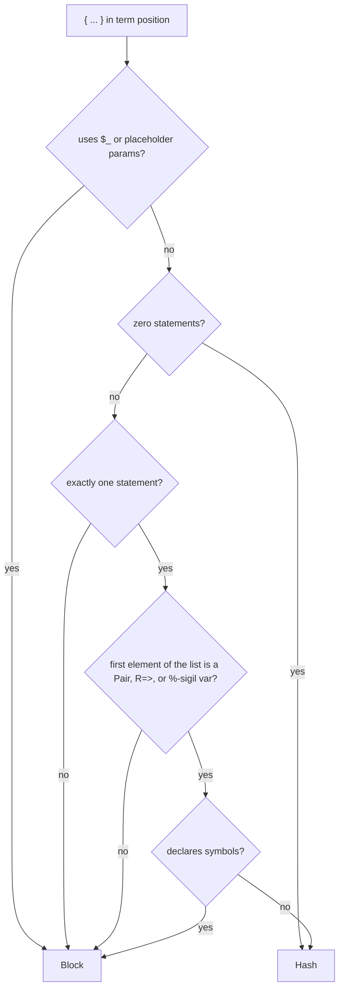

# Curly braces in Raku: Block, Hash, and Subscript

Verified against Rakudo™ Star v2026.08 (Raku v6.d) on MoarVM 2026.08. Source references are to `rakudo/rakudo` (`src/Perl6/Grammar.nqp`, `src/Perl6/Actions.nqp`) and the official docs at the time of writing. Every output shown below was produced with that Rakudo.

## TL;DR

- `{ ... }` in **term position** is parsed once as a block; a compile-time action then reinterprets that block AST as a `Hash` **only when its body looks like a hash**.
- The body looks like a hash when it is empty (comments/whitespace allowed), or a **single statement** that is a comma list whose **first element** is a `Pair` (`a => 1`, `:a(1)`, `'a' R=> 1`), or a `%`-sigiled variable (`%h`, `%!h`, `%*h`), **and** the body uses neither `$_` nor placeholder parameters, declares no symbols, and has arity 0.
- Anything else is a `Block`.
- `%( ... )` and `hash( ... )` are the unambiguous hash constructors. `{; ... }` is the unambiguous block form.
- A `{` that **touches** a preceding term is not a block or a hash constructor at all; it is the `postcircumfix:<{ }>` hash subscript. Whitespace decides.
- Braces in grammar slots that already expect a block (`if`, `for`, `sub`, `do`, `->`, `class` body, …) are always blocks; the hash heuristic never runs there.

## Background

Perl 5 users expect `{ ... }` to build a hash. Raku reverses the default: braces are primarily a block constructor, and the hash interpretation is a narrow, syntax-driven exception. The official docs put it as: "Curly braces are used to declare blocks. However, empty curly braces will declare a hash."

This is not context-sensitive typing. Raku does not look at the left-hand side (`my %h` vs `my $c`) to decide. The same source text produces the same type in every term-position context.

## The three syntactic roles of `{`

| Role | Form | Decided by |
|---|---|---|
| Block, in term position | `{ ... }` | Grammar parses a `pblock`; action keeps it a `Block` |
| Hash constructor, in term position | `{ ... }` | The same action reinterprets a hash-shaped `pblock` as a `Hash` |
| Explicit hash constructor | `%( ... )`, `hash( ... )` | Always a `Hash` |
| Block in a block slot | `if cond { ... }`, `sub f { ... }`, `do { ... }`, `-> { ... }` | Grammar slot; always a `Block` |
| Hash subscript | `expr{ ... }` (no space) | `postcircumfix:<{ }>`; whitespace-sensitive |

## Term `{ ... }`: one parse, two results

### Grammar side

In `src/Perl6/Grammar.nqp`, the term-position brace is a single token:

```nqp
token circumfix:sym<{ }> {
    :my $*FAKE_INFIX_FOUND := 0;
    <?[{]> <pblock($PBLOCK_OPTIONAL_TOPIC)>
    {
        $*BORG<block> := $<pblock>
    }
}
```

`pblock` handles both a pointy block (`-> ... { ... }`) and a plain `blockoid` (`{ ... }`). The grammar does **not** have a separate "hash literal" token for `{`; the distinction is made later, after the contents have been parsed.

### Action side

The decision lives in `method circumfix:sym<{ }>` in `src/Perl6/Actions.nqp`. In simplified pseudocode:

```text
if the block uses $_ (explicitly or implicitly)      -> Block
else if it has zero statements (empty/comment-only)  -> Hash
else if it has exactly one statement:
    e := the statement's expression
    if e is a comma list: e := its first element
    unwrap Want / p6fatalize wrappers
    Hash if e is:
        - a Pair expression (`&infix:«=>»` or any op returning Pair)
        - a reverse pair (`METAOP_REVERSE` over `&infix:«=>»`, i.e. `R=>`)
        - a lexical variable whose name starts with `%` (`%h`, `%!h`)
        - a dynamic variable lookup of a `%`-sigil name (`%*h`)
    but only if:
        - the block declares no symbols (except `$_`, `$*DISPATCHER`)
        - the block has arity 0 (no placeholders such as `$^x`)
else                                                  -> Block
```

If accepted as a hash, the AST is rewritten into a call to `&circumfix:<{ }>` (the `Hash` constructor), with the parsed elements as arguments. When the opening brace is immediately preceded by `:`, the call is `&circumfix:<:{ }>` instead; the same classification rules still apply. An empty accepted body becomes an empty `Hash`.

The docs summarize this as: "If the content is empty, or contains a single list that starts with a `Pair` literal or `%`-sigiled variable, and the `$_` variable or placeholder parameters are not used, the constructor returns a `Hash`." The source is slightly broader (`R=>`, `%*h`) and adds the declared-symbol check.

### Decision flow



## Verified decision table

All rows tested with Rakudo Star v2026.08.

| Source | Result | Reason |
|---|---|---|
| `{ }` | `Hash` | Zero statements |
| `{}` | `Hash` | Zero statements |
| `{ # comment\n}` | `Hash` | Comments are not statements |
| `{;}` | `Block` | Empty statement is not a hash-shaped list |
| `{ ; }` | `Block` | Same |
| `{ ;; }` | `Block` | Same |
| `{ a => 1 }` | `Hash` | Single list, first element Pair |
| `{ a => 1, b => 2 }` | `Hash` | Single comma list, first element Pair |
| `{ a => 1, }` | `Hash` | Trailing comma does not add a statement |
| `{ a => 1; }` | `Hash` | Trailing semicolon does not add a statement |
| `{ :a }` | `Hash` | Colonpair is a Pair |
| `{ :a(1) }` | `Hash` | Colonpair is a Pair |
| `{ :$x }` | `Hash` | Colonpair is a Pair; `$x` is not `$_` |
| `{ 3 => 4 }` | `Hash` | Any `X => Y` is a Pair |
| `{ $x => 1 }` | `Hash` | Any `X => Y` is a Pair |
| `{ @a => 1 }` | `Hash` | Any `X => Y` is a Pair |
| `{ 'a' R=> 1 }` | `Hash` | Reverse pair is recognized |
| `{ %h }` | `Hash` | First element is a `%`-sigil variable |
| `{ %*ENV }` | `Hash` | Dynamic `%`-sigil variable is recognized |
| `{ "a", 1 }` | `Block` | First element is a `Str`, not a Pair/`%` var |
| `{ 1 }` | `Block` | First element is an `Int` |
| `{ $x }` | `Block` | First element is a `$`-sigil var |
| `{ @a }` | `Block` | First element is an `@`-sigil var |
| `{ (a => 1) }` | `Block` | Parenthesized expression, not a bare Pair |
| `{ %(a => 1) }` | `Block` | First element is a call, not a `%` variable |
| `{ %h<a> }` | `Block` | Subscript expression, not a `%` variable |
| `{ a => 1; b => 2 }` | `Block` | Two statements |
| `{ a => 1 given 1 }` | `Block` | Statement modifier wraps the Pair |
| `{ $_ => 1 }` | `Block` | Uses `$_` |
| `{ .foo => 1 }` | `Block` | Implicit `$_` use in `.foo` |
| `{ a => $^x }` | `Block` | Placeholder parameter ⇒ arity 1 |
| `{ a => 1, my $x = 2 }` | `Block` | Declares a symbol |
| `{ my $x = 1; a => 1 }` | `Block` | Declares a symbol and has two statements |
| `{ a => 1, $_ => 2 }` | `Block` | Uses `$_` |
| `%(a => 1)` | `Hash` | Explicit constructor |
| `hash(a => 1)` | `Hash` | Explicit constructor |
| `%( )` | `Hash` | Explicit constructor |
| `{; a => 1 }` | `Block` | Leading semicolon adds a statement |

### Notes on the table

- The `Pair` test is syntactic, not key-type based. `{ $x => 1 }`, `{ @a => 1 }`, `{ 3 => 4 }` and `{ 'a' R=> 1 }` are all hashes. `{ $x }`, `{ @a }`, `{ 1 }` are blocks because the first element is not a pair.
- `Pair` constructors include colonpairs: `:a`, `:a(1)`, `:a<1>`, `:$x`.
- "First element" means the first element of a **comma list**. `{ a => 1, b => 2 }` qualifies; `{ (a => 1), (b => 2) }` does not.
- `$_` use is checked on the block AST, so implicit topic uses count. `{ .foo => 1 }` is a `Block` because `.foo` means `$_.foo`.
- Placeholder parameters (`$^x`, `@^x`, `%^x`, `&^x`) make the block's arity nonzero. That alone forces a `Block`, even when the body starts with a pair.
- A `my` declaration anywhere in the body forces a `Block`; `{ a => 1, my $x = 2 }` is a `Block`.
- A second statement always forces a `Block`; `{ a => 1; b => 2 }` is a `Block` even though its first statement is a pair.
- Leading `;` is the reliable block escape; trailing `;` is not (`{ a => 1; }` is still a `Hash`).

## Explicit constructors and forcing

| Want | Write | Notes |
|---|---|---|
| `Hash` from pairs | `%(a => 1, b => 2)` | Always a `Hash` |
| `Hash` from pairs | `hash(a => 1, b => 2)` | Always a `Hash` |
| Empty `Hash` | `{}` or `%()` | `{}` in term position |
| `Hash` from a list | `%(<a b c>)` etc. | The `%()` coercer |
| Guaranteed `Block` | `{; ... }` | Leading semicolon |
| Empty `Block` | `{;}` | Not `{}` |
| `Block` with explicit params | `-> $x { ... }`, `<-> $x { ... }` | Pointy block |
| `Block`/`Sub` via keyword | `sub { ... }`, `do { ... }` | Grammar block slot |

Examples:

```raku
say {}.^name;             # Hash
say {;}.^name;            # Block
say { a => 1 }.^name;     # Hash
say {; a => 1 }.^name;    # Block
say %(a => 1).^name;      # Hash
say hash(a => 1).^name;   # Hash
```

The `%()` form is the ordinary hash constructor and should be preferred whenever the intent is a hash. It takes the same list syntax as a list assignment:

```raku
my %h = %( a => 1, b => 2 );
my %g = hash( a => 1, b => 2 );
```

`{; ... }` is the idiomatic escape when a block must start with something that would otherwise look like a hash body:

```raku
my @squares = (1..3).map({; $_ ** 2 });
```

Equivalently, mention `$_` or use the explicit `%( ... )` if a hash is actually wanted:

```raku
(1..3).map({ $_ ** 2 });          # Block: $_ is used
(1..3).map({ %( k => $_ ) });     # Block returning a Hash
```

## Where the heuristic does not run

Braces in a grammar slot that already expects a block are parsed with `token block`, not with `token circumfix:sym<{ }>`, so they are never reinterpreted as hashes:

- Control flow: `if`, `unless`, `while`, `until`, `for`, `loop`, `given`, `when`, `with`, `without`, `default`.
- Declarations and routines: `sub`, `method`, `submethod`, `class`, `role`, `grammar`, `module`, `package`, `unit`.
- Phasers and block-taking terms: `do`, `gather`, `start`, `react`, `supply`, `whenever`, `CATCH`, `CONTROL`, `LAST`, `NEXT`.
- Pointy blocks: `-> ... { ... }`, `<-> ... { ... }`.

Consequences:

```raku
say (if True { a => 1 }).^name;   # Pair  — the brace is a block; its value is a Pair
say (do { a => 1 }).^name;        # Pair  — do takes a block
say (sub { a => 1 }).^name;       # Sub
say (-> { a => 1 }).^name;        # Block
```

By contrast, a brace passed to a list operator such as `map`, `grep`, `sort`, or `reduce` is in term position, and the heuristic applies. That is the source of the classic `map` trap below.

## `{` as `postcircumfix:<{ }>` (hash subscript)

When `{` immediately follows a term with no whitespace, it is parsed as a hash subscript, not as a block or constructor:

```raku
my %h = a => 1;
say %h{a};        # 1        hash subscript
say %h<a>;        # 1        angle-bracket subscript
say $x{...};      # subscript on $x
```

A space changes the parse:

```raku
$x{...}           # postcircumfix subscript
$x {...}          # a term (Block or Hash) passed/used separately
```

This is why conditions need a space before their block:

```raku
if $x { ... }     # correct: block
if $x{ ... }      # parsed as subscript on $x, then "missing block"
if ($x){ ... }    # subscript on the parenthesized value
```

Exact Rakudo diagnostics:

```text
===SORRY!=== Error while compiling -e
Missing block (whitespace needed before curlies taken as a hash subscript?)
...
    expecting any of:
        block or pointy block
```

The same issue appears after pointy-block parameters:

```raku
-> $i { ... }     # correct: block
-> $i{ ... }      # parsed as a shape declaration on $i
```

```text
===SORRY!===
Shape declaration is not yet implemented; please use whitespace if you meant something else
```

Where no term precedes the brace, no space is needed: `sub f(){ ... }`, `else { ... }`, `try { ... }`, `CATCH { ... }`.

## `}` at end of line ends the statement

A closing brace followed by a newline behaves like a semicolon. This applies to both blocks and hash constructors:

```raku
my $h = { a => 1, b => 2 }
    .keys.sort;
say $h.^name;      # Hash
```

The `.keys.sort` line is a new statement (operating on `$_`), not a method call on `$h`. Keep the operator on the same line, or escape the newline with an unspace `}\`:

```raku
my @k = { a => 1, b => 2 }\
    .keys.sort;
say @k.raku;       # ["a", "b"]
```

Inside parentheses or square brackets, a line-ending `}` separates elements as if it were a semicolon:

```raku
say [ { a => 1 }
      { b => 2 } ].raku;   # [{:a(1)}, {:b(2)}]
```

## Traps and consequences

### `map` and friends receive a `Hash`, not code

A block body that is only a constant pair is a hash constructor. The result is an argument of type `Hash`, and list operators reject it:

```raku
(1..2).map({ "k" => 1 });
```

```text
Cannot map a Range using a Hash
Did you mean to add a stub ({ ... }) or did you mean to .classify?
```

Fixes:

```raku
(1..2).map({; "k" => 1 });        # leading semicolon forces Block
(1..2).map({ "k$_" => 1 });       # $_ use forces Block
(1..2).map({ %( k => $_ ) });     # Block returning a Hash
```

### Empty braces are a `Hash`, not an empty `Block`

```raku
my &c = {};   # Type check failed in assignment to &c; expected Callable but got Hash ({})
```

Use `{;}` or `sub {}` for an empty callable:

```raku
my &c = {;};
say c();      # Nil
my &d = sub {};
```

### A `Hash` is not code, and a `Block` is not a hash

```raku
my %h = { a => 1 };    # Hash; fine
my $c = { a => 1 };    # Hash, not a callable
my $b = {; a => 1 };   # Block
```

Because the decision ignores the variable's sigil, `my $c = { a => 1 }` does not give you a closure. If you want a closure that returns a hash, write `{ %( a => 1 ) }` or `{; a => 1 }`.

### Wrapping a `%()` in braces changes the type

```raku
say %(a => 1).^name;      # Hash
say { %(a => 1) }.^name;  # Block  (first element is a call, not a % variable)
```

### `%h{...}` is a subscript, not a constructor

```raku
%h{a}        # subscript
%h<a>        # subscript
{ a => 1 }   # constructor/block in term position
```

Keeping the brace attached to the term is what selects the subscript form.

### `$_` is the escape hatch for pair-shaped bodies

`{ $_ => 1 }` and `{ .foo => 1 }` are `Block`s because the topic is used. This is often exactly what a `map`/`grep` body needs. It also means that adding a print, a second statement, or a declaration to a would-be hash body turns it into a block, which is usually the desired error-revealing behavior.

## How to inspect what you got

`^name`, `WHAT`, and `raku` make the distinction visible:

```raku
say { a => 1 }.^name;        # Hash
say {; a => 1 }.^name;       # Block
say { a => 1 }.WHAT;         # (Hash)
say {; a => 1 }.WHAT;        # (Block)
dd { a => 1 };               # {:a(1)}
```

One-liner checks (use `q{...}` or a file to avoid the shell and Raku interpolation eating braces):

```sh
raku -e 'say { a => 1 }.^name'
raku -e 'say {; a => 1 }.^name'
```

## Implementation references

- Grammar: `src/Perl6/Grammar.nqp`
  - `token circumfix:sym<{ }>` — term-position brace, delegates to `pblock`
  - `token pblock` — pointy block or `blockoid`
  - `token block` — grammar block slot
  - `token blockoid` — `{ statementlist }`
  - `token postcircumfix:sym<{ }>` — hash subscript
  - `token postcircumfix:sym<{; }> { <!> }` — forbidden form
- Actions: `src/Perl6/Actions.nqp`
  - `method circumfix:sym<{ }>` — the Block/Hash decision
  - `method pblock`, `method block`, `method blockoid`
- Official docs:
  - <https://docs.raku.org/language/operators#term_{_>
  - <https://docs.raku.org/language/traps#Beware_of_empty_blocks>
  - <https://docs.raku.org/language/syntax> (implied separator / end-of-line `}`)

## Quick reference

```raku
# Hash
{}                       # empty Hash
{ a => 1 }               # Hash
{ a => 1, b => 2 }       # Hash
{ %h }                   # Hash
{ :a(1) }                # Hash
%(a => 1)                # Hash, explicit
hash(a => 1)             # Hash, explicit

# Block
{;}                      # empty Block
{; a => 1 }              # Block
{ "a", 1 }               # Block
{ (a => 1) }             # Block
{ a => 1; b => 2 }       # Block
{ $_ => 1 }              # Block (uses $_)
{ a => $^x }             # Block (placeholder)
{ a => 1, my $x = 1 }    # Block (declares symbol)
{ %(a => 1) }            # Block (first element is a call)
sub { ... }              # Sub
-> $x { ... }            # Block with params
do { ... }               # block in a block slot

# Subscript
%h{a}                    # hash subscript
%h<a>                    # hash subscript
$x{...}                  # subscript on $x
if $x { ... }            # block; space matters
```
