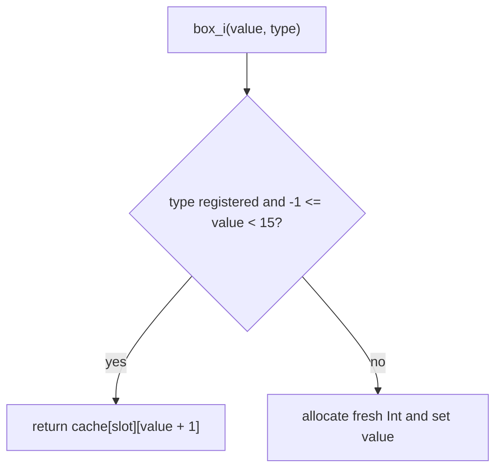

# Boxing, `Scalar`, and integer representation in Raku

Verified against Rakudo Star 2026.08 (Raku v6.d) on MoarVM 2026.08. Source references are to those versions.

## Boxing

Raku's language semantics are object-oriented: values you manipulate are objects. The VM nevertheless has native, non-object representations for performance and for interfacing with native code:

| Native type | Boxed object type | Representation |
|---|---|---|
| `int` | `Int` | signed 64-bit |
| `uint` | `Int` (non-negative; `UInt` is a subset of `Int`) | unsigned 64-bit |
| `num` | `Num` | double |
| `str` | `Str` | VM string |

**Boxing** is wrapping a native value in an object so it can participate in the object protocol: method calls, type checks, storage in object containers, generic operators. **Unboxing** is extracting the native value again. The compiler inserts these conversions automatically at boundaries.

```raku
my $x = 42;
say $x.WHAT;        # (Int)      <- boxed value
say $x.VAR.^name;   # Scalar     <- container around it

my int $n = 42;
say $n.WHAT;        # (Int)      <- boxed on demand for .WHAT
say $n.VAR.^name;   # IntLexRef  <- native lexical slot, not a Scalar
```

Boxing normally allocates an `Int` object. The VM caches boxes for a few small values on common paths; this does not apply to every construction path. See [Small-integer interning](#small-integer-interning--114) below.

## `Scalar`

`Scalar` is the default **container** for `$` variables and for `@`/`%` elements. It is a mutable cell around a value, not a kind of number.

A `Scalar` supplies:

- assignment and mutability (`STORE`/`FETCH` internally), so `$x = 5` works;
- an optional type constraint (`.of`);
- a default value (`.default`);
- itemization: `$x` counts as one item in list context;
- identity for the variable, separate from the value's identity.

```raku
my $x = 1;
my $y = $x;      # copy the value into a new Scalar
my $z := $x;     # bind to the SAME Scalar
$z = 2;
say $x;          # 2

$y = 9;
say $x;          # 2 — $y is a separate container
```

Binding bypasses the container:

```raku
my $raw := 42;
say $raw.VAR.^name;  # Int — no Scalar
$raw = 43;           # error: Cannot assign to an immutable value
```

A typed variable has a constrained container:

```raku
my Int $x = 42;
say $x.VAR.^name;  # Scalar
say $x.VAR.of;     # (Int)
```

For an untyped `my $x = 42`, the container's constraint is `Mu` and its default is `Any`. `Scalar` instances are created implicitly by binding; `Scalar.new` is not supported.

### Containers are broader than `Scalar`

Native lexicals use native reference containers (`IntLexRef`, `NumLexRef`, ...), and native arrays use `array[int]`. `nqp::iscont` tests “is this a container reference”, not “is this a `Scalar`”:

```raku
use nqp;
my $x = 1;
my int $n = 1;
my $b := 1;

say nqp::iscont($x);  # 1
say nqp::iscont($n);  # 1 — native lexical is still a container ref
say nqp::iscont($b);  # 0 — direct binding, no container
```

Other containers include `Array`, `Hash`, and `Proxy`. `.VAR` on a value returns its container, or the value itself if it is not in one.

`=:=` compares container identity. `===` compares value identity; for value types such as `Int`, that means value equality, not object identity.

## Are ints always boxed?

No. Whether a given integer is boxed depends on its declaration, storage, and the context in which it is used.

| Code | Storage | Boxed? |
|---|---|---|
| `42`, `my $x = 42` | `Int` inside a `Scalar` | yes |
| `my Int $x = 42` | `Int` inside a typed `Scalar` | yes |
| `my $x := 42` | bare `Int`, no container | yes, but no `Scalar` |
| `my int $x = 42` | native 64-bit slot | no; boxes when read into object context |
| `my int @a = 1, 2` | `array[int]` | no; element read is boxed |
| `has int $.x` | native attribute | no; accessor boxes when used as an object |

The rule is: **an integer is boxed whenever it must be observed as an object; native declarations, parameters, returns, attributes, and arrays keep it unboxed until that boundary.**

Boxing boundaries include:

- storing into an object container (`my $x`, `@a[...]`, `%h{...}`);
- calling a method (`.WHAT`, `.say`, `.Str`, ...);
- passing to a parameter typed as `Mu` or a boxed type;
- returning a native value into an object context;
- using generic operators that dispatch on objects.

Native integers are fixed-width 64-bit and wrap on overflow:

```raku
my int $x = 9223372036854775807;
say $x + 1;   # -9223372036854775808
```

`Int` is arbitrary precision. Native `int` also avoids boxing, but generic operations can force boxes anyway; use native types where measurements show a benefit.

Representation and container-ness are independent axes:

- **representation:** native value vs boxed object;
- **container:** no container vs `Scalar`/lexical ref/array slot.

`Scalar` does not imply boxing, and boxing does not imply `Scalar`. `my $x := 42` is a boxed `Int` with no container. `my int $x = 42` is an unboxed value in a native container reference.

## Small-integer interning: `-1..14`

### What “interned” means here

For each registered integer **box type**, MoarVM preallocates one `Int` object for every value in

$$\{-1, 0, 1, \dots, 14\}$$

and every boxing operation that asks for one of those values returns that same object. This is a **closed, pre-populated pool**, not a growing intern table: nothing is added on lookup, and only those 16 values are affected.

```raku
use nqp;
my $zero = 0;

say nqp::objectid(5 + $zero) == nqp::objectid(5 + $zero);      # True
say nqp::objectid(400 + $zero) == nqp::objectid(400 + $zero);  # False
say nqp::objectid(Int.new(5)) == nqp::objectid(Int.new(5));    # False
```

`===` does not reveal interning, because `Int` is a value type:

```raku
say 5 === 5;               # True
say 400 === 400;           # True
say 4 === 4.0;             # False
```

Use `nqp::objectid` only for debugging. Do not use object identity as program logic.

### The cache in the source

From `src/core/intcache.h`:

```c
struct MVMIntConstCache {
    MVMObject *types[4];
    MVMObject *cache[4][16];
};

#define MVM_INTCACHE_RANGE_CHECK(value) ((value) >= -1 && (value) < 15)
```

So:

- up to **4 box types** can be registered;
- 16 slots per type;
- slot 0 holds `-1`, slot 1 holds `0`, …, slot 15 holds `14`.

`MVM_intcache_get` is effectively:

```c
if (value < -1 || value >= 15)
    return NULL;

for each registered type:
    if (type matches)
        return cache[slot][value + 1];

return NULL;
```

It never allocates and never inserts. `MVM_repr_box_int` in `src/6model/reprconv.c` does:

```c
res = MVM_intcache_get(tc, type, val);
if (res == 0) {
    res = MVM_repr_alloc_init(tc, type);
    MVM_repr_set_int(tc, res, val);
}
```



### How the cache is populated and kept alive

`MVM_intcache_for` eagerly allocates all 16 objects for a type:

```c
for (val = -1; val < 15; val++) {
    obj = MVM_repr_alloc_init(tc, type);
    MVM_repr_set_int(tc, obj, val);
    cache[type_index][val + 1] = obj;
    MVM_gc_root_add_permanent_desc(tc, ...);
}
```

Registration happens:

- for `BOOTInt` during 6model bootstrap (`src/6model/bootstrap.c`);
- for an HLL’s configured `int_box_type` when HLL configuration is set (`src/core/hll.c`). In Rakudo that is `Int`.

Implementation details:

- The HLL registration enables “allocate in gen2” first, so these boxes are old-generation objects and do not churn the nursery.
- Each cache entry and the type itself is a **permanent GC root**. They live for the life of the VM instance. That is bounded — at most 4 x 16 boxes — not a leak.
- Lookup takes no mutex; registration does (`mutex_int_const_cache`). Once published, entries are immutable, so sharing them across threads is safe.
- Duplicate registration of the same type is a no-op. If all four type slots are occupied by other types, a fifth type gets no cache.
- For these values the underlying `P6bigint` body stores the value inline as a smallint (`MVM_BIGINT_32_FLAG`), so there is no separate `mp_int` allocation inside the cached box.

### Why exactly `-1..14`?

It is a fixed 16-entry pool, and history explains the boundary:

- 2014 commit `96e7aaf5d`: “implement a constant cache for ints 0 to 16” — the code cached **0..15**.
- 2015 commit `9da66bcc4` by Timo Paulssen: “sacrifice 15 for -1 in the int cache. -1 is very popular!”

So `15` was removed to make room for `-1` without growing the array. Consequently:

- `-1` is cached;
- `0..14` are cached;
- `-2` and `15` are not cached.

This is a MoarVM implementation detail, not a Raku language guarantee. It is conceptually similar to Java’s `Integer` cache or Python’s small-int cache, but much smaller and hardcoded.

### Which boxing paths hit the cache

- `nqp::box_i($value, Int)` -> `box_i` opcode -> `MVM_repr_box_int` -> cache.
- Numeric coercion such as `Int($x)` -> boxing path -> cache.
- Autoboxing a native `int` into an object parameter (`src/core/args.c`).
- Small-integer results of bigint arithmetic (`src/math/bigintops.c`): the small path calls `MVM_intcache_get` and returns the cached box directly on a hit.
- Deserialization of small integer constants (`src/6model/serialization.c`). This is why a literal `5` and a computed `5` can share a box.
- After spesh, `box_i` is lowered to `sp_fastbox_i_ic`; the interpreter and JIT check the range and load the cache slot. Out-of-range values go through a fresh allocation.

```c
/* src/core/interp.c, sp_fastbox_i_ic */
if (value >= -1 && value < 15) {
    dst.o = int_const_cache->cache[slot][value + 1];
} else {
    /* fresh object */
}
```

Unsigned values use the same pool for `0..14`: `sp_fastbox_u_ic` checks `value < 15`, and the unsigned autobox path rejects negative values.

### Which paths bypass it

- `Int.new($x)` always allocates a fresh object. Rakudo’s `Int.new` uses `nqp::fromI_I`, whose `coerce_II` implementation calls `MVM_bigint_from_bigint` -> `MVM_repr_alloc_init`. The comment in `Int.rakumod` says it reboxes “so we get rid of any potential mixins.” Interning would defeat that.
- Any value outside `-1..14`.
- Any box type that was never registered in the cache.
- Direct `MVM_repr_alloc_init` / `nqp::create` paths.

Being outside the cache does not necessarily mean a big-integer allocation: `P6bigint` stores values up to 32 bits inline too. It does mean a **fresh object** each time.

### Values are shared; containers are not

```raku
my $a = 5;
my $b = 5;

say $a.VAR =:= $b.VAR;   # False — two distinct Scalar containers
say nqp::objectid(nqp::decont($a.VAR)) ==
    nqp::objectid(nqp::decont($b.VAR));   # True — same Int box

$a = 6;
say $b;                  # 5 — assignment copied a value, not a container
```

Each `$` variable still gets its own `Scalar`. Interning applies only to the boxed value inside, not to variable or container identity.

### What interning buys, and what it does not

It buys:

- no allocation and no GC pressure when boxing `-1..14` through ordinary boxing paths;
- stable object identity for those boxes, which is safe because `Int` is immutable;
- bounded memory: at most 64 cached box objects plus the type references.

It does not buy:

- unboxed integers — a cached `Int` is still a heap object, still a pointer dereference, still object dispatch;
- general small-int coverage — `15`, `400`, etc. allocate on each box;
- an absence of allocation for `my $i = 0; $i++` indefinitely: only the small values are free, after that each new `Int` result is a fresh box;
- any language-level guarantee.

For hot numeric code, use native `int` (`my int $i`, `int @a`, `has int $.x`, `sub f(int $x)`) rather than relying on the cache. Do not use `nqp::objectid` or interning as program logic — the range is an implementation detail and can change.

## Rules of thumb

1. Use `my $x` for ordinary mutable values; it is a `Scalar` holding a value.
2. Use `my $x := $y` to alias a container; use `my $x := 42` for an immutable direct binding.
3. Use `my int $x`, native attributes, native arrays, and `int` signatures for hot numeric storage.
4. Remember that native value representation and container type are independent.
5. Treat `Int` as a value type: compare with `==`/`eqv`/`===`, not by object identity.
6. Treat `-1..14` interning as an optimization to be aware of, not a behavior to rely on.

## Source references

MoarVM 2026.08:

- `src/core/intcache.h`, `src/core/intcache.c`
- `src/6model/reprconv.c` — `MVM_repr_box_int`
- `src/core/interp.c` — `box_i`, `sp_fastbox_i_ic`, `sp_fastbox_u_ic`
- `src/6model/bootstrap.c`, `src/core/hll.c` — cache registration
- `src/core/args.c` — autoboxing of native arguments
- `src/math/bigintops.c` — small-integer arithmetic results
- `src/6model/serialization.c` — small integer constants
- `src/6model/reprs/P6bigint.c` — inline smallint storage
- commits `96e7aaf5d` (2014) and `9da66bcc4` (2015)

Rakudo 2026.08:

- `src/core.c/Int.rakumod` — `Int.new` reboxing via `nqp::fromI_I`
- `src/core.c/Scalar.rakumod` — container and native-reference types
