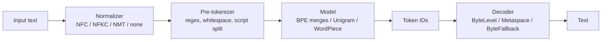

# Tokenization, Unicode, and Non-Latin Alphabetic Languages

*Measured notes. Numbers below were generated on 2026-11-05 with tiktoken 0.14.0,
tokenizers 0.23.3, transformers 5.22.1 and sentencepiece 0.2.3. The harness and
the exact samples are in Appendix B.*

## What this document answers

1. Why the same sentence costs a different number of tokens depending on the script.
2. Which of the resulting problems are cost, and which are correctness bugs.
3. How to measure a tokenizer before committing to it.
4. What can actually be changed, and what only looks like a fix.
5. Which library to reach for, and what each one will not do for you.

The short version: BPE operates on UTF-8 **bytes**, and the merge table is
allocated by corpus frequency. A language that is 2–4 bytes per character and
rare in the training mix gets few merges, so its text fragments into
sub-words, single characters, or raw bytes. Alphabetic scripts with low corpus
share (Amharic, Georgian, Armenian, Tamil, Bengali, Thai) are worse off than
CJK, which is 3 bytes per character but extremely frequent and has a small,
stable inventory. The dominant variable is not the encoding; it is the
vocabulary allocation.

## TL;DR

- A non-Latin letter is 2–4 byte-symbols before any merge. English is 1.
- Tokenizers trained mostly on English spend most of their vocabulary on Latin
  byte sequences. In `cl100k_base`, 89.6% of entries are Latin-script and 15
  entries are Devanagari.
- In the measured samples, `cl100k_base` needed 36 tokens for a 64-character
  Russian sentence and 10 for a 44-character English one; `o200k_base` needed
  15 for the same Russian sentence. Same text, same tokenizer family, 2.4×
  difference traceable to vocabulary size and training mix.
- The worst measured case was `cl100k_base` on a 26-character Amharic sentence:
  65 tokens, 60 of them raw bytes, 43 token boundaries inside grapheme clusters.
- Cluster boundaries, normalization, and `[UNK]` are correctness problems.
  Token count is a cost problem. They need different fixes.
- "Byte fallback" preserves round-trip and destroys semantics. `[UNK]` destroys
  information outright. Neither is support for a script.
- Measure fertility, bytes per token, raw-byte/`[UNK]` rate, and grapheme-cluster
  break rate on your own corpus. A single sentence is an illustration, not a
  benchmark.

## 1. Four different units

A tokenizer sits at the intersection of four units that are easy to conflate:

| Unit | Example | Size |
|---|---|---|
| byte | `0xD0 0x9C` | 1 byte each |
| Unicode code point | `М` U+041C | 2 bytes in UTF-8 |
| grapheme cluster (UAX #29) | `e` + U+0301 | 2 code points, 3 bytes, one visible glyph |
| token | whatever the vocabulary holds | 1 byte to several characters |

UTF-8 length is fixed by code point range:

| Code points | UTF-8 bytes | Examples |
|---|---|---|
| U+0000–U+007F | 1 | ASCII, Latin without diacritics |
| U+0080–U+07FF | 2 | Latin-1 letters, Greek, Cyrillic, Hebrew, Arabic |
| U+0800–U+FFFF | 3 | Devanagari, Bengali, Tamil, Thai, Ethiopic, Georgian, Armenian, Han, Kana, Hangul |
| U+10000–U+10FFFF | 4 | emoji, rare scripts, some CJK extensions |

Two strings can be equal as text and different as bytes:

```text
é      U+00E9           2 bytes  (NFC, precomposed)
é      e + U+0301       3 bytes  (NFD, decomposed)
```

The measured tokenizers disagree about this. With `cl100k_base`:

```text
precomposed "é"     1 token : é
decomposed   "é"     2 tokens: e · ́
```

With XLM-R and Qwen2.5, both forms become one token, because their normalizers
compose the sequence before segmenting:

```text
XLM-R  decomposed "é"  1 token : é
Qwen   decomposed "é"  1 token : é
```

One emoji can be even more extreme. The family emoji is one grapheme cluster,
seven code points, 25 UTF-8 bytes, and up to 19 tokens:

```text
👨‍👩‍👧‍👦
cl100k  18 tokens: \xf0\x9f · \x91 · \xa8 · \xe2\x80 · \x8d · ... (11 raw bytes)
Qwen2.5 10 tokens: 👨 · \xe2\x80 · \x8d · 👩 · \xe2\x80 · \x8d · 👧 · \xe2\x80 · \x8d · 👦
```

So "one character" is not a useful unit anywhere in a tokenizer pipeline. The
only safe unit for display and streaming is the grapheme cluster; the only safe
unit for storage is bytes or code points with a declared normalization form.

## 2. How BPE consumes Unicode

### 2.1 The pipeline



Every stage can change the token count and the identity of the text.

### 2.2 Byte-level BPE

The GPT-2 family (`gpt2`, `r50k_base`, `p50k_base`, `cl100k_base`,
`o200k_base`) starts from 256 byte symbols and learns pair merges:

1. Count adjacent symbol pairs over the corpus.
2. Merge the most frequent pair into a new symbol.
3. Repeat until the vocabulary budget is exhausted.

Because the base alphabet is all 256 byte values, every input is representable
and decoding is lossless. But a symbol is a *byte sequence*, not a character. A
merge table learned on English has almost nothing to say about the byte
sequences that make up Amharic, so those characters remain one, two, or three
symbols each — and they may be split at any byte boundary, including inside a
UTF-8 encoding of a single character.

That is exactly what `cl100k_base` does to Greek and Hebrew. It emits
`\xce` and `\x97` as separate tokens for `Η`, and `י\xd7` and `\xaa` for `י`:

```text
Greek "Η"   cl100k: \xce · \x97
Hebrew "י"  cl100k: י\xd7 · \xaa
```

Each token boundary is inside a code point, hence inside a grapheme cluster.

### 2.3 SentencePiece and WordPiece

SentencePiece can train BPE or a unigram language model over raw text. It
supports `byte_fallback`: symbols outside the vocabulary are emitted as
`<0xNN>` tokens, which decode back to the original bytes. It also adds a
dummy prefix space by default, which is why a first token often looks like
`␣The`, and it normalizes according to the model's `normalization_rule_name`
(`nmt_nfkc` by default for many models).

WordPiece (BERT, mBERT) uses greedy longest-match over a vocabulary and marks
continuations with `##`. It has `[UNK]` rather than byte fallback: a character
outside the vocabulary is replaced, not encoded. In the measurements below,
mBERT turned an entire Amharic sentence into `[UNK]` tokens and kept one
content token (the final punctuation).

### 2.4 Pre-tokenization is where space-free scripts break

GPT-2's pre-tokenizer is a regex that groups letters and numbers:

```text
's|'t|'re|'ve|'m|'ll|'d| ?\p{L}+| ?\p{N}+| ?[^\s\p{L}\p{N}]+|\s+(?!\S)|\s+
```

`\p{L}+` treats an entire run of letters with no whitespace as one "word". For
English that is the right unit. For Thai, Lao, Khmer, Burmese and Tibetan,
where spaces do not delimit words, the whole clause becomes one unit and BPE
then splits it arbitrarily. For scripts with combining marks, the regex does
not keep marks attached to their base in any linguistically meaningful way;
that is left to the merge table.

`cl100k_base` uses a similar pattern with `\p{N}{1,3}` for digits. The
practical consequence is that a Thai sentence is tokenized with no knowledge
of Thai word boundaries, and a numeral like `12345` is chunked by a rule that
has nothing to do with the language.

## 3. What the vocabulary actually contains

Vocabulary size alone says little. What matters is how many entries serve each
script. I classified every vocabulary entry by the majority script of its
alphabetic characters; entries that are byte fragments, punctuation, digits or
markers are left unclassified, so these are lower bounds and the columns do not
sum to 100%.

| encoding | vocab | Latin | Cyrillic | Arabic | Devanagari | Hebrew | Greek | Han | Kana | Hangul | Thai | Ethiopic | Georgian |
|---|---|---|---|---|---|---|---|---|---|---|---|---|---|
| cl100k | 100256 | 89823 (89.6%) | 736 (0.7%) | 98 (0.1%) | 15 (0.0%) | 22 (0.0%) | 44 (0.0%) | 867 (0.9%) | 163 (0.2%) | 299 (0.3%) | 46 (0.0%) | 0 | 0 |
| o200k | 199998 | 134776 (67.4%) | 14212 (7.1%) | 7965 (4.0%) | 3900 (2.0%) | 2361 (1.2%) | 1507 (0.8%) | 7506 (3.8%) | 754 (0.4%) | 2373 (1.2%) | 1539 (0.8%) | 0 | 2200 (1.1%) |
| gpt2 | 50256 | 47003 (93.5%) | 18 (0.0%) | 19 (0.0%) | 0 | 11 (0.0%) | 22 (0.0%) | 50 (0.1%) | 132 (0.3%) | 2 (0.0%) | 0 | 0 | 0 |
| XLM-R | 250002 | 109981 (44.0%) | 31670 (12.7%) | 14423 (5.8%) | 7515 (3.0%) | 5141 (2.1%) | 5174 (2.1%) | 17773 (7.1%) | 2788 (1.1%) | 5413 (2.2%) | 4299 (1.7%) | 2951 (1.2%) | 3770 (1.5%) |
| mBERT | 119547 | 66542 (55.7%) | 13795 (11.5%) | 4680 (3.9%) | 1740 (1.5%) | 2450 (2.0%) | 1564 (1.3%) | 13548 (11.3%) | 1329 (1.1%) | 3273 (2.7%) | 320 (0.3%) | 0 | 705 (0.6%) |
| Mistral | 32000 | 25980 (81.2%) | 1731 (5.4%) | 57 (0.2%) | 32 (0.1%) | 27 (0.1%) | 75 (0.2%) | 1459 (4.6%) | 133 (0.4%) | 346 (1.1%) | 44 (0.1%) | 8 (0.0%) | 29 (0.1%) |
| Qwen2.5 | 151665 | 94494 (62.3%) | 4144 (2.7%) | 3979 (2.6%) | 56 (0.0%) | 3159 (2.1%) | 235 (0.2%) | 25469 (16.8%) | 1776 (1.2%) | 3586 (2.4%) | 2550 (1.7%) | 112 (0.1%) | 35 (0.0%) |

Three things stand out:

1. **`cl100k_base` is an English tokenizer with guests.** 89.6% Latin, 15
   Devanagari entries, zero Ethiopic and zero Georgian. Greek has 44 entries
   for a 24-letter alphabet; that is enough to cover some frequent bigrams but
   not the language.
2. **`o200k_base` is the same architecture with a bigger, more balanced
   vocabulary.** It has 19× the Cyrillic entries, 260 times the
   Devanagari entries, and 2,200 Georgian entries. The measured cost drops
   accordingly (Russian 36 → 15 tokens, Georgian 73 → 12).
3. **Multilingual models make a different trade.** XLM-R's 250k vocabulary is
   broad but still 44% Latin; mBERT's 120k is 56% Latin; Mistral's 32k is 81%
   Latin and has 32 Devanagari entries. Qwen2.5 spends 16.8% of its vocabulary
   on Han and only 56 entries on Devanagari, which matches its measured
   behaviour: excellent Chinese, poor Hindi.

`o200k_base` has zero Ethiopic entries by this classification, yet it improves
on `cl100k` for Amharic (65 → 48 tokens) because it has more byte-sequence
merges that happen to cover Ethiopic syllables. Vocabulary share is a useful
predictor, not a law.

## 4. Scripts, with measured examples

Notation in the blocks below: `␣` marks a leading space inside a token; `\xNN`
is a raw byte that is not valid UTF-8 on its own. Token counts exclude
BOS/EOS/CLS/SEP/PAD; `[UNK]`/`<unk>` is reported separately. Cluster-break
counts are only quoted for tokenizers whose pieces reconstruct the source bytes
exactly (all byte-level models, XLM-R and Mistral); WordPiece's pre-tokenizer
drops whitespace around punctuation, so mBERT is excluded from that metric.

### 4.1 English baseline

```text
"The quick brown fox jumps over the lazy dog."   44 chars, 44 bytes, 9 words

cl100k 10 tok: The · ␣quick · ␣brown · ␣fox · ␣jumps · ␣over · ␣the · ␣lazy · ␣dog · .
XLM-R  13 tok: The · ␣quick · ␣brown · ␣ · fox · ␣jump · s · ␣over · ␣the · ␣la · zy · ␣dog · .
```

English is the case every tokenizer is optimized for: roughly 1.1 tokens per
word, no cluster breaks, no raw bytes. It is the denominator for every other
comparison in this document.

### 4.2 Latin with diacritics: French and Vietnamese

```text
"L'élève étudie la linguistique comparée."   40 chars, 44 bytes, 5 words

cl100k 13 tok: L · ' · él · ève · ␣ét · ud · ie · ␣la · ␣lingu · istique · ␣compar · ée · .
o200k  12 tok: L · 'él · ève · ␣ét · ud · ie · ␣la · ␣lingu · istique · ␣compar · ée · .
```

French is close to English: 2.6 tokens per word for `cl100k`, 2.4 for `o200k`.
The precomposed `é` is one token; the cost comes from the apostrophe and the
longer words, not from Unicode.

Vietnamese is the hard Latin case. It stacks tone marks and vowel modifiers on
a Latin base, so each syllable is 2–3 bytes, and the byte sequences are far
less frequent in an English corpus:

```text
"Học sinh học tiếng Việt mỗi ngày."   33 chars, 44 bytes, 7 words

cl100k 16 tok: H · ọc · ␣sinh · ␣h · ọc · ␣ti · ế · ng · ␣Vi · ệ · t · ␣m · ỗi · ␣ng · ày · .
gpt2   31 tok, 15 raw-byte, 10 cluster breaks:
       H · \xe1 · \xbb · \x8d · c · ␣sin · h · ... (the bytes of "ọ", "ế", "ệ", "ỗ" split)
XLM-R   8 tok: Học · ␣sinh · ␣học · ␣tiếng · ␣Việt · ␣mỗi · ␣ngày · .
```

The same text is 2.3 tokens per word in `cl100k`, 1.3 in `o200k`, and 1.1 in
XLM-R, which has Vietnamese in its training mix. `gpt2` is 4.4 tokens per word
and splits 15 of 31 tokens into raw bytes.

The lesson is not "Latin is safe". It is "Latin script with a low-frequency
diacritic pattern behaves like any other low-resource script".

### 4.3 Greek

```text
"Η γλώσσα είναι το σπίτι του πολιτισμού."   39 chars, 71 bytes, 7 words

cl100k  34 tok, 6 raw-byte, 3 cluster breaks:
        \xce · \x97 · ␣γ · λ · \xcf · \x8e · σ · σ · α · ␣ε · ί · ν · αι · ␣τ · ο · ...
o200k   12 tok: Η · ␣γ · λώ · σσα · ␣είναι · ␣το · ␣σπίτι · ␣του · ␣πολι · τισ · μού · .
XLM-R    8 tok: Η · ␣γλώσσα · ␣είναι · ␣το · ␣σπίτι · ␣του · ␣πολιτισμού · .
Mistral 39 tok: Η · ␣ · γ · λ · ώ · σ · σ · α · ␣ · ε · ...
```

Greek has 24 letters and is 2 bytes per character. That does not save it:
`cl100k` has 44 Greek entries, so it tokenizes close to one character per
token, and occasionally splits a character's bytes. `o200k`'s 1,507 Greek
entries bring it to 1.7 tokens per word. Mistral's 32k vocabulary has 75 Greek
entries, so it is one character per token — 39 tokens for 7 words.

A script with a small alphabet still needs vocabulary entries for its common
bigrams and suffixes. Alphabet size is not the predictor; merge allocation is.

### 4.4 Cyrillic

```text
"Москва — столица России, а Санкт-Петербург — культурная столица."
64 chars, 119 bytes, 9 words

cl100k  36 tok: М · ос · к · ва · ␣— · ␣ст · ол · и · ца · ␣Р · ос · с · ии · , · ...
o200k   15 tok: Москва · ␣— · ␣столи · ца · ␣России · , · ␣а · ␣Санкт · -Петербург · ...
XLM-R   14 tok: Москва · ␣— · ␣столица · ␣России · , · ␣а · ␣Санкт · - · Петербург · ...
Mistral 24 tok: Моск · ва · ␣— · ␣сто · ли · ца · ␣России · , · ␣а · ␣Сан · кт · ...
```

Cyrillic is the best-documented "middle" case: 2 bytes per character, highly
inflected, and present in most multilingual corpora. The measured spread is
2.4× between `cl100k` (4.0 tokens/word) and `o200k` (1.7 tokens/word), and 4.5×
against `gpt2` (7.6 tokens/word, 18 raw bytes, 12 cluster breaks). All four
tokenizers here use whole code points; the raw bytes in `gpt2` are the
exception that proves the rule — they come from byte-level BPE, not from
Cyrillic itself.

### 4.5 Hebrew and Arabic

Both are 2 bytes per character, written right-to-left, and have no case. The
tokenizer sees logical order; bidi reordering is a display concern. That means
bidi control characters (U+202A–U+202E, U+2066–U+2069) should be removed before
tokenization, not counted as text. They are also a prompt-injection vector,
because they can make a string read differently from what it is.

```text
"השפה העברית היא שפה שמית עתיקה."   31 chars, 56 bytes, 6 words

cl100k  29 tok, 9 raw-byte, 7 cluster breaks:
        ה · ש · \xd7 · \xa4 · ה · ␣ה · ע · ב · ר · י\xd7 · \xaa · ␣ה · י\xd7 · \x90 · ...
o200k   13 tok: הש · פה · ␣הע · בר · ית · ␣היא · ␣ש · פה · ␣שמ · ית · ␣עת · יקה · .
XLM-R   12 tok: ה · שפה · ␣העברית · ␣היא · ␣ · שפה · ␣שמ · ית · ␣ · עת · יקה · .
```

```text
"اللغة العربية من أقدم اللغات السامية."   37 chars, 68 bytes, 6 words

cl100k  23 tok: ال · ل · غ · ة · ␣ال · ع · ر · ب · ية · ␣من · ␣أ · ق · د · م · ...
o200k   11 tok: ال · لغة · ␣العربية · ␣من · ␣أ · قدم · ␣الل · غات · ␣الس · امية · .
XLM-R    9 tok: اللغة · ␣العربية · ␣من · ␣أ · قدم · ␣اللغات · ␣الس · امية · .
```

Hebrew is the more expensive of the two in the measured tokenizers: 4.8
tokens/word in `cl100k` versus 3.8 for Arabic. Both improve by 2× or more in
`o200k`. Mistral's small vocabulary is close to one character per token for
both (31 tokens for the Hebrew sentence, 29 for the Arabic one).

#### Arabic with harakat (vocalization)

Adding short vowels and shadda changes the picture: the marks are separate
combining code points, and every tokenizer in the measurement splits at least
some of them from their base letter.

```text
"اللُّغَةُ العَرَبِيَّةُ جَمِيلَةٌ."   34 chars, 65 bytes, 3 words

cl100k  30 tok, 15 cluster breaks: ال · ل · ُ · ّ · غ · َ · ة · ُ · ␣ال · ع · َ · ر · ...
o200k   22 tok, 14 cluster breaks: الل · ُ · ّ · غ · َ · ة · ُ · ␣الع · َر · َب · ِي · ...
XLM-R   25 tok, 12 cluster breaks: الل · ُّ · غ · َ · ة · ُ · ␣الع · َ · ر · َ · ب · ِ · ...
```

The marks inflate the count for the same content (30 tokens for 34 characters,
against 23 for 37 unvocalized characters in `cl100k`), and around half of all
token boundaries now fall inside a grapheme cluster. A streamer that emits tokens as
they arrive will render a combining mark on the wrong base, or a bare mark.
This is the same class of bug as splitting a ZWJ emoji sequence.

The same applies to Hebrew niqqud (U+05B0–U+05BC) and to Indic vowel signs.
Normalization does not fix it: NFC does not compose Arabic letter + haraka into
a single code point, because Unicode does not define such compositions.

### 4.6 Devanagari

```text
"हिन्दी भारत की सबसे अधिक बोली जाने वाली भाषा है।"
48 chars, 126 bytes, 10 words

cl100k  49 tok, 17 raw-byte, 33 cluster breaks:
        ह · ि\xe0\xa4 · \xa8 · ्\xe0\xa4 · \xa6 · ी · ␣\xe0\xa4 · \xad · ा\xe0\xa4 · \xb0 · त · ...
o200k   14 tok, 2 cluster breaks:
        ह · िन्द · ी · ␣भारत · ␣की · ␣सबसे · ␣अधिक · ␣बो · ली · ␣जाने · ␣वाली · ␣भाषा · ␣है · ।
XLM-R   11 tok: हिन्दी · ␣भारत · ␣की · ␣सबसे · ␣अधिक · ␣बोली · ␣जाने · ␣वाली · ␣भाषा · ␣है · ।
Qwen2.5 46 tok, 30 cluster breaks: (not shown; 56 Devanagari entries in the vocabulary)
```

Devanagari is 3 bytes per character, and its vowel signs (matras) are separate
combining code points. The word `हिन्दी` is six code points in two grapheme
clusters (the virama joins `न्द`); `cl100k` gives it six tokens, with
boundaries inside the matra `ि` and inside the UTF-8 encoding of `न`. The conjunct `क्ष` (`क` + virama +
`ष`) is three code points and one cluster; tokenizers that do not know it will
split it.

`o200k` is 3.5× cheaper than `cl100k` here and cuts cluster breaks from 33 to
2. XLM-R is better still. Qwen2.5, despite being a modern multilingual model
with a 151k vocabulary, is nearly as bad as `cl100k` on Hindi: it has 56
Devanagari entries. Vocabulary share predicts this exactly.

### 4.7 Bengali and Tamil

The Dravidian and Eastern Indic scripts show the same pattern with more
agglutination and longer words.

```text
"বাংলা ভাষা দক্ষিণ এশিয়ার একটি গুরুত্বপূর্ণ ভাষা।"
49 chars, 135 bytes, 7 words

cl100k  62 tok, 27 raw-byte, 44 cluster breaks
o200k   14 tok, 5 cluster breaks: বাংল · া · ␣ভাষ · া · ␣দক্ষিণ · ␣এ · শ · িয় · ার · ...
XLM-R    9 tok: বাংলা · ␣ভাষা · ␣দক্ষিণ · ␣এশিয়া · র · ␣একটি · ␣গুরুত্বপূর্ণ · ␣ভাষা · ।
```

```text
"தமிழ் மொழி மிகப் பழமையான மொழிகளில் ஒன்றாகும்."
45 chars, 123 bytes, 6 words

cl100k  63 tok, 28 raw-byte, 44 cluster breaks
o200k   15 tok, 6 cluster breaks
XLM-R   12 tok, 2 cluster breaks
gpt2   123 tok, 117 raw-byte, 94 cluster breaks
```

Bengali is 8.9 tokens per word in `cl100k` and 1.3 in XLM-R. Tamil is 10.5
tokens per word in `cl100k` and 2.0 in XLM-R; `gpt2` spends more tokens than
the text has bytes (123 tokens for 123 bytes, 117 of them raw bytes). The
`cl100k` vocabulary has 15 Devanagari entries and effectively nothing for
Tamil; the model is transliterating the script into bytes.

### 4.8 Thai: no spaces, no word boundaries

```text
"ภาษาไทยเป็นภาษาที่มีเสียงวรรณยุกต์"   34 chars, 102 bytes, 1 whitespace-delimited run

cl100k  36 tok, 4 raw-byte, 10 cluster breaks:
        \xe0\xb8 · \xa0 · า · \xe0\xb8 · \xa9 · า · ไ · ท · ย · เ · ป · ็ · น · ...
o200k   13 tok, 1 cluster break: ภาษา · ไทย · เป็น · ภ · าษ · าที่ · มี · เสียง · ว · รรณ · ...
XLM-R    9 tok: ภาษาไทย · เป็น · ภาษา · ที่มี · เสียง · วรรณ · ยุ · ก · ต์
Qwen2.5  17 tok, 6 cluster breaks
```

There are no spaces between words, so "tokens per word" is undefined here; the
whitespace pre-tokenizer sees one run of 34 characters. `cl100k` costs 1.06
tokens per character, about 4.6× the English per-character cost, and 10 of its
34 token boundaries fall inside a grapheme cluster (Thai vowel and tone marks
stack above and below the base). XLM-R, which has Thai coverage and a
word-aware SentencePiece model, gets the whole sentence into 9 tokens.

If you need word-level behaviour for Thai, Lao, Khmer, Burmese or Tibetan, you
need a dictionary or ICU word-break segmenter before BPE. A regex over
whitespace cannot supply what the script does not have.

### 4.9 Amharic (Ethiopic)

```text
"አማርኛ የኢትዮጵያ የመንግስት ቋንቋ ነው።"   26 chars, 70 bytes, 5 words

cl100k  65 tok, 60 raw-byte, 43 cluster breaks: (2.5 tokens per character)
o200k   48 tok, 22 raw-byte, 22 cluster breaks
XLM-R    5 tok: አማርኛ · ␣የኢትዮጵያ · ␣የመንግስት · ␣ቋንቋ · ␣ነው።
mBERT    0 content tokens, 6 [UNK]  (the sentence is discarded)
Mistral 52 tok, 39 raw-byte, 26 cluster breaks
```

Ethiopic is a syllabary: each base character encodes a consonant–vowel
syllable, with several hundred signs in the U+1200 block. It is 3 bytes per
character and rare in English-dominated corpora, which is the worst
combination. `cl100k` emits 60 raw bytes out of 65 tokens — it is not
tokenizing Amharic, it is storing its UTF-8. mBERT replaces every content
character with `[UNK]`, so a downstream model sees a sentence of six unknown
tokens.

This is the clearest case where "the tokenizer supports Unicode" is true in a
trivial sense (no crash, round-trip via bytes) and false in every useful sense.

### 4.10 Georgian and Armenian

```text
"ქართული ენა ქართველების მშობლიური ენაა."
39 chars, 107 bytes, 5 words

cl100k  73 tok, 34 raw-byte, 34 cluster breaks (14.6 tokens/word)
o200k   12 tok: ქართული · ␣ე · ნა · ␣ქართველ · ების · ␣მშ · ობლ · იური · ␣ე · ნა · ა · .
XLM-R   10 tok: ქართული · ␣ენა · ␣ქართველები · ს · ␣ · მშობლ · იური · ␣ენა · ა · .

"Հայերենը հնդեվրոպական լեզու է։"   30 chars, 57 bytes, 4 words

cl100k  57 tok, 54 raw-byte, 27 cluster breaks (14.2 tokens/word)
o200k   13 tok, 1 raw-byte
XLM-R   11 tok
```

Georgian and Armenian have their own alphabets, 3 bytes per character, and
small corpora. `cl100k` has zero Georgian and zero Armenian entries, so both
come out near one token per byte: 14 tokens per word. `o200k`
fixes Georgian almost completely (2,200 entries) and Armenian mostly.

These are the cases that most clearly separate "large vocabulary" from
"multilingual". `o200k` did not add a Georgian language model; it added 2,200
merge entries, and that was enough to bring the cost from 73 tokens to 12.

### 4.11 CJK: the counter-example

CJK is often described as expensive because each character is 3 bytes. In
practice it is the best-served non-Latin family, because the character
inventory is bounded and extremely frequent.

```text
"中文是世界上最古老的语言之一。"   15 chars, 45 bytes

cl100k  17 tok, 2 raw-byte: 中 · 文 · 是 · \xe4\xb8 · \x96 · 界 · 上 · 最 · ...
o200k   11 tok: 中文 · 是 · 世界 · 上 · 最 · 古 · 老 · 的 · 语言 · 之一 · 。
Qwen2.5  7 tok: 中文 · 是 · 世界上最 · 古老 · 的语言 · 之一 · 。
```

```text
"日本語は文法が英語と大きく異なります。"   19 chars, 57 bytes

cl100k  21 tok, 3 raw-byte
o200k   16 tok
Qwen2.5 14 tok
XLM-R   10 tok: 日本語 · は · 文 · 法 · が · 英語 · と · 大きく · 異なります · 。
```

Korean is instructive because Hangul is alphabetic in structure (jamo) and
3 bytes per syllable in its precomposed form:

```text
"한국어는 교착어로서 조사가 발달했다."   20 chars, 52 bytes, 4 words

cl100k  23 tok, 7 raw-byte, 7 cluster breaks (5.8 tokens/word)
o200k   14 tok (3.5/word)
XLM-R   11 tok (2.8/word)
gpt2    46 tok, 38 raw-byte (11.5/word)
```

`cl100k` splits some Hangul syllables into partial UTF-8; `o200k` and XLM-R do
not. If the text is decomposed into jamo (NFD), the cost rises further unless
the normalizer composes it first.

CJK is not the problem case. Alphabetic scripts with low corpus share and
combining marks are.

### 4.12 Tibetan and Cherokee: fallback and UNK

```text
"བོད་ཡིག་ནི་བོད་ཀྱི་ཡིག་སྐད་ཡིན།"   31 chars, 93 bytes, 1 whitespace run

cl100k  64 tok, 35 raw-byte, 42 cluster breaks
o200k   48 tok, 24 raw-byte, 33 cluster breaks
XLM-R    3 content tokens, 4 [UNK]
mBERT   16 content tokens, 5 [UNK]
Mistral 45 tok, 21 raw-byte, 23 cluster breaks
```

```text
"ᏣᎳᎩ ᎦᏬᏂᎯᏍᏗ ᎠᏂᏴᏫ ᎤᏤᎵᎢ."   21 chars, 55 bytes, 4 words

cl100k  52 tok, 48 raw-byte, 34 cluster breaks
o200k   55 tok, 51 raw-byte, 34 cluster breaks
XLM-R    4 content tokens, 4 [UNK]
mBERT    1 content token (the period), 4 [UNK]
Qwen2.5 33 tok, 15 cluster breaks
```

Two different failure modes:

- **Byte fallback** (the GPT-2 family, Mistral here) preserves the bytes and
  therefore the text, at 2–3 tokens per character. The model sees a sequence
  with no linguistic units.
- **`[UNK]`** (XLM-R, mBERT) loses the information. A downstream model cannot
  recover the word from `<unk>`, and any token-level statistic is meaningless.

Neither is "support". The difference matters for what you can do next: with
byte fallback you can still round-trip, search and display the text; with
`[UNK]` you cannot.

Cherokee is also a reminder that a larger vocabulary does not guarantee
improvement: `o200k` is slightly *worse* than `cl100k` here (55 vs 52 tokens,
51 vs 48 raw bytes), while Qwen2.5 is better (33 tokens). Vocabulary
composition is not monotone in size.

### 4.13 Emoji, ZWJ sequences and variation selectors

```text
👨‍👩‍👧‍👦   7 code points, 25 bytes, 1 grapheme cluster

cl100k  18 tok, 11 raw-byte, 17 cluster breaks (100% of interior boundaries)
o200k   11 tok, 4 raw-byte, 10 cluster breaks
Qwen2.5 10 tok, 9 cluster breaks
XLM-R    7 tok, 6 cluster breaks

👍🏽      2 code points, 8 bytes, 1 cluster
cl100k   6 tok
Qwen2.5  2 tok

🏳️‍🌈     4 code points, 14 bytes, 1 cluster
cl100k   9 tok
Qwen2.5  5 tok
```

The family emoji is the strongest single example in this document: one visible
glyph, 18 tokens, and every interior token boundary inside the cluster. A
token-level streaming loop will paint the family one person at a time, with
dangling ZWJ characters between them. A cursor movement or truncation routine
that counts tokens will cut the glyph in half.

### 4.14 Agglutinative morphology: Finnish, Turkish, Hungarian, Swahili

Byte cost is not the whole story. Turkish is mostly 1 byte per character in
Latin script, yet its morphology produces long words and many suffix chains:

```text
"Türkçe, eklemeli bir dil olduğu için sözcükler uzayabilir."
58 chars, 64 bytes, 8 words

cl100k  22 tok (2.8/word): T · ür · k · ç · e · , · ␣ek · lem · eli · ␣bir · ␣dil · ...
o200k   19 tok (2.4/word)
XLM-R   15 tok (1.9/word): Türkçe · , · ␣ek · leme · li · ␣bir · ␣dil · ␣olduğu · ...
```

A single Finnish word can be many tokens:

```text
"talossanikin"   ("in my house too")   12 chars, 12 bytes

cl100k  5 tok: tal · oss · an · ik · in
o200k   4 tok: tal · oss · an · ikin
XLM-R   4 tok: tal · ossa · ni · kin
```

Finnish, Hungarian, Turkish and Swahili are 2.8–3.2 tokens per word in
`cl100k`, versus 1.1 for English. The cost comes from suffix boundaries, not
from UTF-8. A vocabulary trained with these languages gets the suffixes as
units and the cost drops toward 1.8–2.6.

## 5. What actually breaks

### 5.1 Cost

- **Context window.** The same information needs 2–6× the tokens for several
  scripts in the measured tokenizers. Against the English sample, the measured
  `cl100k` sentences cost 3.6× for Russian, 4.9× for Hindi and 6.5× for Amharic,
  so an 8k-token budget holds proportionally less of each.
- **Money and latency.** Both scale with tokens on most APIs. Tokenizers that
  fragment a script make that script more expensive per unit of meaning.
- **Attention dilution.** Longer sequences for the same content mean weaker
  per-token signal and more chances for the model to lose a fact. This is a
  modelling claim, not something the measurements here prove; the token-count
  disparity is measured, the quality effect is inferred.

### 5.2 Cluster boundaries

Measured interior-boundary rates for the worst samples:

| Sample | cl100k | o200k | XLM-R | Mistral |
|---|---|---|---|---|
| Arabic with harakat | 52% | 67% | 50% | 47% |
| Hindi | 69% | 15% | 0% | 36% |
| Bengali | 72% | 38% | 0% | 50% |
| Tamil | 71% | 43% | 18% | 52% |
| Thai | 29% | 8% | 0% | 21% |
| Amharic | 67% | 47% | 0% | 51% |
| Emoji ZWJ | 100% | 100% | 100% | 100% |

Consequences that are easy to ship as bugs:

- **Streaming.** Emit only at grapheme-cluster boundaries (UAX #29), buffering
  incomplete clusters. Otherwise a combining mark arrives before its base, or a
  ZWJ sequence is painted piecewise.
- **Truncation.** Cutting at N tokens can cut a cluster in half, leaving a
  dangling combining mark. Cut at token *and* cluster boundaries.
- **Constrained decoding / token healing.** If a grammar constrains the next
  characters, the token boundary may force a partial code point. Token healing
  or byte-level constraints are needed.
- **Editing and search.** A cursor or highlight that indexes tokens or code
  points will move through one visible glyph multiple times.
- **Diffing.** Token-level diffs of two languages with different fertility are
  not comparable, and a diff that splits inside a cluster renders badly.

### 5.3 Normalization

- **Same text, different tokens.** NFC and NFD forms of `é` are 1 and 2 tokens
  in `cl100k`. Arabic with and without harakat, or with different alef forms
  (`أ` vs `ا`), tokenizes differently and compares unequal as strings.
- **NFKC is lossy.** It folds full-width forms, ligatures, superscripts and
  some presentation forms. It is the right choice when compatibility matters
  and the wrong choice when the exact source text matters.
- **Do not normalize twice.** If the tokenizer normalizes and your code also
  does, offsets and equality checks may disagree. Pick one canonical form at
  the boundary and record it.
- **Security.** Bidi controls, zero-width characters and Unicode tag characters
  can hide text. Strip them before tokenizing untrusted input, and keep the
  visible text separate from the wire text.

### 5.4 `[UNK]` versus byte fallback

- `[UNK]` makes the model blind to the text and makes any per-token metric
  wrong. If a language is in scope and the `[UNK]` rate is non-trivial, the
  tokenizer does not cover it.
- Byte fallback preserves the text but spends 1 token per byte. A 90% raw-byte
  rate means the vocabulary has no linguistic units for the script.
- Both can be present in the same model: some SentencePiece models have byte
  fallback and still emit `<unk>` for characters the normalizer maps away.

### 5.5 Metrics stop being comparable

Perplexity is per token. A model with a 4× higher fertility on Language A will
look better or worse than it is when compared to Language B on token-level
metrics. Compare bits per character or bits per byte, or normalize by fertility.
BLEU and other surface metrics computed on token sequences inherit the same
problem.

## 6. Measuring your own tokenizer

### 6.1 Definitions

For a corpus per language:

| Metric | Definition | What it tells you |
|---|---|---|
| fertility | tokens / whitespace word | cost per word for spaced scripts |
| tokens per character | tokens / code point | script-level fragmentation |
| bytes per token | UTF-8 bytes / token | compression; often around 4 for natural English text |
| raw-byte rate | raw-byte tokens / tokens | how much of the text is stored as bytes |
| UNK rate | `[UNK]` tokens / tokens | information loss |
| cluster-break rate | interior token boundaries not on a UAX #29 boundary / interior boundaries | rendering and streaming risk |
| parity ratio | tokens for a parallel text / tokens for its English version | fairness across languages |

The last one requires a parallel corpus. Single translated sentences are
illustrations; use a few thousand sentences per language before drawing
conclusions.

### 6.2 Minimal harness

```python
import regex, tiktoken
from transformers import AutoTokenizer

# byte-level model
enc = tiktoken.get_encoding("o200k_base")
ids = enc.encode("हिन्दी")
pieces = [enc.decode_single_token_bytes(i).decode("utf-8", "backslashreplace") for i in ids]

# SentencePiece / WordPiece model, with offsets
tok = AutoTokenizer.from_pretrained("xlm-roberta-base", use_fast=True)
out = tok("हिन्दी", return_offsets_mapping=True, add_special_tokens=False)
print(out.tokens(), out["offset_mapping"])
```

Cluster boundaries, without a full Unicode library:

```python
clusters = regex.findall(r"\X", text)          # UAX #29 grapheme clusters
starts, pos = set(), 0
for c in clusters:
    starts.add(pos)                            # pos in bytes, see note
    pos += len(c.encode())
```

If you work in bytes, encode each cluster and accumulate byte lengths; if you
work in code points, accumulate `len(c)`. Do not mix the two. The `regex`
module's `\X` is the practical implementation of UAX #29 in Python.

### 6.3 Pitfalls that produce wrong numbers

1. **Counting special tokens.** `encode()` may add `<s>`, `[CLS]`, `[SEP]`.
   Strip them before comparing counts. In the measurements above, they are
   excluded.
2. **The dummy prefix space.** SentencePiece's `add_dummy_prefix` inserts a
   leading space and fuses it into the first token (`␣The`) or emits it as a
   separate token. Remove one leading space before computing byte offsets, or
   every offset after it shifts by one.
3. **Normalization drift.** If the tokenizer normalizes (NFKC, NMT) and your
   reference text does not, offsets reconstructed from pieces will not line up.
   Normalize the reference with the same rule for the comparison, or use the
   tokenizer's own offsets.
4. **Confusing offsets.** Hugging Face `tokenizers` offsets index the original
   string in code points (a six-character Cyrillic token reports `(5, 11)`),
   not bytes. Byte-level models have no character offsets until you decode.
5. **Decoding partial bytes.** A byte-level token may not be valid UTF-8 on its
   own. Decode with `errors="backslashreplace"` when printing, and keep the raw
   bytes for measurement.
6. **One sentence.** The samples here are deliberately short and chosen to
   illustrate mechanisms. They are not a corpus and their ratios will not
   generalize exactly.

### 6.4 What the measurements show

English is the baseline at ~1.1 tokens per word. For the same sentence content,
`cl100k` costs 4.0 tokens/word in Russian, 4.9 in Greek and Hindi, 8.9 in
Bengali, 10.5 in Tamil, 13.0 in Amharic and 14.6 in Georgian. `o200k` brings
those to 1.7, 1.7, 1.4, 2.0, 2.5, 9.6 and 2.4 respectively. XLM-R is close to
1–2 tokens/word for most of them, at the cost of a 250k vocabulary and a
different model family.

The full per-sample table is in Appendix A. The important reading is the
shape, not the exact numbers: the spread between tokenizers on the same text is
often larger than the spread between languages.

## 7. What can be changed

### 7.1 Fix the vocabulary, not the decoder

The only real fix is to allocate vocabulary and training data to the languages
you care about:

- Train or extend the merge table on a corpus that has the target languages in
  proportion to their importance to you. A 1% share produces a 1%-quality
  tokenizer for that language, regardless of vocabulary size.
- Increase vocabulary size if you can afford the embedding matrix. The measured
  `cl100k` → `o200k` change is essentially this, plus a better training mix.
- Prefer a tokenizer trained on the scripts you need over a larger one trained
  on English. XLM-R's 250k vocabulary beats `cl100k`'s 100k on every non-Latin
  sample here.

### 7.2 Transplant a tokenizer into an existing model

If you must keep the model:

1. Train or choose the new tokenizer.
2. Expand the embedding matrix for the new tokens.
3. Initialize new embeddings (mean of the old embeddings, or train them).
4. Freeze or slowly unfreeze the old embeddings.
5. Continue pretraining on a balanced corpus.

This is standard practice but it is a training project, not a configuration
flag. It also changes the token-to-logit mapping, so any saved prompt,
constraint or cached token sequence must be re-encoded.

### 7.3 Script-aware pre-tokenization

If you control the tokenizer, split on script boundaries and keep combining
marks with their base. With Hugging Face `tokenizers`:

```python
from tokenizers import Tokenizer, models, trainers, pre_tokenizers, decoders, normalizers

tok = Tokenizer(models.BPE(byte_fallback=True))
tok.normalizer = normalizers.NFC()
tok.pre_tokenizer = pre_tokenizers.Sequence([
    pre_tokenizers.UnicodeScripts(),                      # split runs by script
    pre_tokenizers.Metaspace(replacement="▁", prepend_scheme="always"),
])
tok.decoder = decoders.Sequence([decoders.Metaspace(replacement="▁", prepend_scheme="always"),
                                decoders.ByteFallback()])
tok.train_from_iterator(corpus, trainers.BpeTrainer(
    vocab_size=64000,
    special_tokens=["<unk>", "<s>", "</s>"],
))
```

`UnicodeScripts` splits a mixed-script run into script-homogeneous pieces
(verified: `helloПривет` becomes `hello` and `Привет`), which stops one script
from stealing merges from another. It does not by itself keep Indic matras or
Arabic harakat attached; that needs a rule or a pre-segmented corpus.

For space-free scripts, replace the whitespace/regex pre-tokenizer with a word
segmenter (ICU, `pythainlp`, `khmer-nltk`, or a trained SentencePiece model
over raw text). BPE will still split within a word, but it will at least start
from linguistic units.

### 7.4 Choose the normalization deliberately

- **NFC** for storage and comparison, unless you need byte-identical source
  text.
- **NFKC** only when compatibility is intended (full-width, ligatures,
  presentation forms). It is lossy.
- **None** when the exact code points matter (security, source code, hashes,
  signed content). Then the tokenizer's own normalizer must be disabled, or
  your equality checks must use the normalized form.

Whichever you choose, do it once, at the boundary, and record which form the
text is in.

### 7.5 Stream at grapheme boundaries

Buffer token output until a complete UAX #29 cluster is available. In Go,
`github.com/rivo/uniseg` provides the segmenter; in Python, `regex` with `\X`;
in Rust, `unicode-segmentation`. This is cheap and prevents the most visible
class of multilingual rendering bug.

The same rule applies to truncation: cut at a cluster boundary, and do not
split a ZWJ sequence or leave a combining mark without its base.

### 7.6 What not to do

- **Do not "fix" fertility by counting characters.** Token limits, pricing and
  context windows are in tokens. A UI that shows "characters remaining" is
  lying to the user.
- **Do not use byte fallback as evidence of support.** It is a lossless
  emergency path, not a language model.
- **Do not compare perplexity across languages without normalizing by bytes or
  characters.**
- **Do not add a language to the vocabulary without adding it to the training
  mix.** A merge entry that never appears in pretraining is dead weight.

## 8. Tokenizer libraries

### 8.1 Comparison

| Library | Core | Training | Normalizers | Pre-tokenizers | Byte fallback | Offsets | Best for |
|---|---|---|---|---|---|---|---|
| `tiktoken` | Rust, Python bindings | no | none | fixed regex per encoding | n/a (byte-level) | `decode_with_offsets` | OpenAI-compatible inference, exact reproduction of GPT encodings |
| `tokenizers` (HF) | Rust, Python/Node bindings | BPE, Unigram, WordPiece, WordLevel | NFC/NFD/NFKC/NFKD, NMT, ByteLevel, Replace, Strip | ByteLevel, Metaspace, Whitespace, Punctuation, Digits, UnicodeScripts, Split | `models.BPE(byte_fallback=True)` + `decoders.ByteFallback` | `Encoding.offsets` (code points) | Training, custom pipelines, fast batch encoding |
| `sentencepiece` | C++, Python wrapper | BPE, Unigram, Word, Char | `nmt_nfkc`, `nfkc`, `nfd`, identity | Metaspace-style, dummy prefix | `--byte_fallback` | `EncodeAsOffsetMapping` | Raw-text training, Llama/Mistral/T5-style models |
| `transformers.AutoTokenizer` | wrapper over the above | via `train_new_from_iterator` | whatever the model uses | whatever the model uses | model-dependent | fast tokenizers only | Loading a published model's tokenizer |
| `tokenmonster` | C | yes | limited | n/a | no | n/a | English-centric compact vocabularies |
| `gigatoken` | Rust/Python | yes | limited | configurable | n/a | n/a | Very fast training/inference experiments |

The table is about capabilities, not quality. A library cannot add vocabulary
coverage that the model was not trained with.

### 8.2 `tiktoken`

`tiktoken` reproduces OpenAI's encodings (`gpt2`, `r50k_base`, `p50k_base`,
`p50k_edit`, `cl100k_base`, `o200k_base`). It is byte-level BPE with no
normalizer: you get exactly the bytes you pass in.

```python
import tiktoken

enc = tiktoken.get_encoding("o200k_base")
ids = enc.encode("hello")                   # special tokens not allowed
ids = enc.encode_ordinary("hello")          # never treats text as special
pieces = [enc.decode_single_token_bytes(i) for i in ids]
text = enc.decode(ids)
```

Notes:

- The first use of a named encoding downloads its BPE file from OpenAI's blob
  storage; there is no training API and no normalizer.
- `encode()` recognises special-token strings; `encode_ordinary()` does not.
  For untrusted text, `encode_ordinary()` is the safer default.
- `decode_single_token_bytes()` is the right primitive for measurement: a token
  can be a partial UTF-8 sequence.
- `decode_with_offsets()` returns the decoded text and the offsets of token
  boundaries in it; it is not a general character-alignment API.
- The model registry (`encoding_for_model`) changes over time. Pin the encoding
  name, not the model name, in anything reproducible.

Use it when you need OpenAI-compatible token counts or an exact reproduction of
a published encoding. Do not use it to train a tokenizer.

### 8.3 Hugging Face `tokenizers`

This is the most flexible pipeline. It separates normalizer, pre-tokenizer,
model, post-processor and decoder, and exposes a trainer for each model type.

```python
from transformers import AutoTokenizer
from tokenizers import Tokenizer, models, trainers, pre_tokenizers, decoders

fast = AutoTokenizer.from_pretrained("bert-base-multilingual-cased", use_fast=True)
tok = fast.backend_tokenizer
enc = tok.encode("हिन्दी")
print(enc.tokens, enc.offsets)

tok = Tokenizer(models.BPE(unk_token="<unk>"))
tok.pre_tokenizer = pre_tokenizers.ByteLevel(add_prefix_space=False)
tok.decoder = decoders.ByteLevel()
tok.train_from_iterator(texts, trainers.BpeTrainer(vocab_size=32000,
                                                   special_tokens=["<unk>"]))
```

Notes:

- `Encoding.offsets` are in code points in the Python API (verified: a
  six-character Cyrillic token reports `(5, 11)`). Do not treat them as bytes.
- `BpeTrainer(byte_fallback=True)` is silently ignored in 0.23; put
  `byte_fallback=True` on `models.BPE` and add `decoders.ByteFallback()`.
- `UnigramTrainer` accepts a `byte_fallback` kwarg that is currently ignored;
  check the version before relying on it.
- `pre_tokenizers.UnicodeScripts()` splits mixed-script runs by script. It is
  newer than the oldest releases; pin a version if you depend on it.
- Batch methods (`encode_batch`) and Rust-backed parallelism are the reason to
  choose this for training corpora.

Use it when you are training or auditing a tokenizer, or when you need a
pipeline that differs from a published model's.

### 8.4 `sentencepiece`

SentencePiece trains directly on raw text and ships a protobuf model. It is the
format behind Llama, Mistral, T5, XLM-R and many multilingual models.

```python
import sentencepiece as spm

spm.SentencePieceTrainer.train(
    input="corpus.txt",
    model_prefix="sp",
    vocab_size=64000,
    model_type="bpe",              # or "unigram", "word", "char"
    byte_fallback=True,            # <0xNN> for anything outside the vocabulary
    character_coverage=1.0,        # default is 0.9995; 1.0 keeps rare scripts
    normalization_rule_name="nmt_nfkc",
    add_dummy_prefix=True,
)

sp = spm.SentencePieceProcessor(model_file="sp.model")
print(sp.encode("हिन्दी", out_type=str))
print(sp.encode("हिन्दी", out_type=int))
print(sp.encode("हिन्दी", out_type=str, enable_sampling=True, alpha=0.1, nbest_size=-1))
```

Notes:

- `character_coverage=0.9995` (the default) drops the rarest 0.05% of
  characters from the vocabulary. For a low-resource script, that can be most
  of its distinct characters. Set it to `1.0` if coverage matters more than
  vocabulary efficiency.
- `byte_fallback=True` is what produces `<0xNN>` tokens. It preserves
  round-trip but, as measured above, can dominate the output for scripts with
  no coverage.
- `add_dummy_prefix=True` inserts a leading space. It changes the first token
  and the offsets; remove it before aligning with the source.
- `EncodeAsOffsetMapping` gives character offsets; `IsByte(id)` identifies
  byte-fallback tokens.
- `model_type="unigram"` often segments agglutinative languages better than
  BPE because it optimizes a likelihood rather than greedily merging pairs.

Use it when you train from raw text and want a compact, portable model file,
especially for multilingual corpora.

### 8.5 `transformers.AutoTokenizer`

This is a loader, not a tokenizer implementation. It wraps a fast `tokenizers`
backend or a slow Python implementation.

```python
from transformers import AutoTokenizer

tok = AutoTokenizer.from_pretrained("Qwen/Qwen2.5-0.5B", use_fast=True)
print(tok.is_fast)
out = tok("हिन्दी", return_offsets_mapping=True, add_special_tokens=False)
print(out.tokens(), out["offset_mapping"])
```

Notes:

- `return_offsets_mapping` requires a fast tokenizer. Check `tok.is_fast`.
- The tokenizer can add special tokens by default; pass
  `add_special_tokens=False` when measuring.
- `tok.add_tokens([...])` appends tokens but does not retrain merges; new
  tokens are matched greedily and can change segmentation of existing text.
- `tok.train_new_from_iterator(...)` trains a new tokenizer for the same model
  family, but the model's embeddings must then be resized.
- `trust_remote_code=True` executes code from the model repository. Do not use
  it on untrusted models.
- Fast and slow implementations can differ on edge cases (normalization,
  whitespace). Pin the transformers version when reproducing counts.

Use it to load a published model's exact tokenizer. Do not use it as your
primary training API; `tokenizers` or `sentencepiece` is clearer.

### 8.6 Interoperability

- A SentencePiece model can be converted to a `tokenizers` pipeline with
  `convert_slow_tokenizer`, and `tokenizers` can export `tokenizer.json`.
- A `tokenizers` model can be saved as `tokenizer.json` and loaded by
  `transformers` with `use_fast=True`.
- Byte-level BPE vocabularies from `tiktoken` are not directly loadable by
  `tokenizers`; you can reconstruct the merge table, but special-token handling
  and the pre-tokenizer regex must be reproduced separately.
- Changing a tokenizer changes token IDs. Any cached token sequence, prompt
  template, grammar constraint or fine-tuning dataset must be re-encoded.

## 9. Decision checklist

Before adopting a tokenizer for a multilingual product:

1. List the scripts and languages in scope, with expected corpus share.
2. Measure fertility, bytes/token, raw-byte rate, `[UNK]` rate and
   cluster-break rate on a per-language corpus, not on one sentence.
3. Check the vocabulary composition for each script (the table in section 3 is
   the shape of the check).
4. Decide the normalization form and enforce it at one boundary.
5. Decide how streaming and truncation handle grapheme clusters.
6. Decide whether token-level metrics are comparable; if not, switch to
   bits-per-byte or per-character normalization.
7. If the answer is "train a new tokenizer", budget for the embedding resize
   and continued pretraining, not just the tokenizer training.
8. If the answer is "use a bigger vocabulary", verify on your languages; the
   Cherokee result above shows that size alone is not monotone.

## Appendix A: measured tables

Versions: tiktoken 0.14.0, tokenizers 0.23.3, transformers 5.22.1,
sentencepiece 0.2.3. Models: `cl100k_base`, `o200k_base`, `gpt2`,
`xlm-roberta-base`, `bert-base-multilingual-cased`, `Mistral-7B-v0.1`,
`Qwen2.5-0.5B`. Counts exclude BOS/EOS/CLS/SEP/PAD; `[UNK]` is excluded from
the content-token count and reported separately.

### A.1 Token counts

| sample | chars | bytes | words | cl100k | o200k | gpt2 | XLM-R | mBERT | Mistral | Qwen2.5 |
|---|---|---|---|---|---|---|---|---|---|---|
| `en` | 44 | 44 | 9 | 10 | 10 | 10 | 13 | 13 | 12 | 10 |
| `fr` | 40 | 44 | 5 | 13 | 12 | 17 | 12 | 11 | 14 | 13 |
| `de` | 65 | 66 | 7 | 16 | 11 | 26 | 12 | 12 | 17 | 16 |
| `vi` | 33 | 44 | 7 | 16 | 9 | 31 | 8 | 8 | 21 | 9 |
| `ru` | 64 | 119 | 9 | 36 | 15 | 68 | 14 | 12 | 24 | 21 |
| `el` | 39 | 71 | 7 | 34 | 12 | 43 | 8 | 12 | 39 | 31 |
| `he` | 31 | 56 | 6 | 29 | 13 | 34 | 12 | 11 | 31 | 14 |
| `ar` | 37 | 68 | 6 | 23 | 11 | 32 | 9 | 10 | 29 | 12 |
| `ar-harakat` | 34 | 65 | 3 | 30 | 22 | 38 | 25 | 26 | 31 | 29 |
| `hi` | 48 | 126 | 10 | 49 | 14 | 73 | 11 | 12 | 48 | 46 |
| `bn` | 49 | 135 | 7 | 62 | 14 | 98 | 9 | 10 | 55 | 53 |
| `ta` | 45 | 123 | 6 | 63 | 15 | 123 | 12 | 11 | 59 | 50 |
| `th` | 34 | 102 | 1 | 36 | 13 | 68 | 9 | 21 | 34 | 17 |
| `am` | 26 | 70 | 5 | 65 | 48 | 66 | 5 | 0 | 52 | 31 |
| `ka` | 39 | 107 | 5 | 73 | 12 | 103 | 10 | 18 | 39 | 39 |
| `hy` | 30 | 57 | 4 | 57 | 13 | 57 | 11 | 13 | 34 | 30 |
| `tr` | 58 | 64 | 8 | 22 | 19 | 32 | 15 | 16 | 31 | 19 |
| `fi` | 40 | 40 | 5 | 14 | 13 | 17 | 9 | 13 | 17 | 14 |
| `fi-word` | 12 | 12 | 1 | 5 | 4 | 5 | 4 | 4 | 5 | 5 |
| `hu` | 33 | 35 | 5 | 16 | 13 | 20 | 9 | 10 | 16 | 16 |
| `sw` | 68 | 68 | 9 | 27 | 19 | 29 | 15 | 14 | 31 | 27 |
| `zh` | 15 | 45 | 1 | 17 | 11 | 24 | 7 | 15 | 15 | 7 |
| `ja` | 19 | 57 | 1 | 21 | 16 | 28 | 10 | 16 | 21 | 14 |
| `ko` | 20 | 52 | 4 | 23 | 14 | 46 | 11 | 12 | 22 | 15 |
| `bo` | 31 | 93 | 1 | 64 | 48 | 85 | 3 | 16 | 45 | 42 |
| `chr` | 21 | 55 | 4 | 52 | 55 | 52 | 4 | 1 | 55 | 33 |
| `emoji-zwj` | 7 | 25 | 1 | 18 | 11 | 14 | 7 | 0 | 19 | 10 |
| `emoji-skin` | 2 | 8 | 1 | 6 | 3 | 5 | 2 | 0 | 2 | 2 |
| `emoji-flag` | 4 | 14 | 1 | 9 | 6 | 9 | 4 | 0 | 10 | 5 |
| `combining` | 2 | 3 | 1 | 2 | 2 | 3 | 1 | 2 | 2 | 1 |
| `precomposed` | 1 | 2 | 1 | 1 | 1 | 1 | 1 | 1 | 1 | 1 |

`mBERT` counts of 0 or 1 on `am`, `chr`, `emoji-*` mean the content was
`[UNK]`: Amharic 6 UNK, Cherokee 4 UNK, each emoji row 1 UNK. XLM-R also
emits 4 UNK on `bo` and 4 on `chr`, so its counts there are content tokens
only.

### A.2 Tokens per space-delimited word

| sample | cl100k | o200k | gpt2 | XLM-R | mBERT | Mistral | Qwen2.5 |
|---|---|---|---|---|---|---|---|
| `en` | 1.1 | 1.1 | 1.1 | 1.4 | 1.4 | 1.3 | 1.1 |
| `fr` | 2.6 | 2.4 | 3.4 | 2.4 | 2.2 | 2.8 | 2.6 |
| `de` | 2.3 | 1.6 | 3.7 | 1.7 | 1.7 | 2.4 | 2.3 |
| `vi` | 2.3 | 1.3 | 4.4 | 1.1 | 1.1 | 3.0 | 1.3 |
| `ru` | 4.0 | 1.7 | 7.6 | 1.6 | 1.3 | 2.7 | 2.3 |
| `el` | 4.9 | 1.7 | 6.1 | 1.1 | 1.7 | 5.6 | 4.4 |
| `he` | 4.8 | 2.2 | 5.7 | 2.0 | 1.8 | 5.2 | 2.3 |
| `ar` | 3.8 | 1.8 | 5.3 | 1.5 | 1.7 | 4.8 | 2.0 |
| `ar-harakat` | 10.0 | 7.3 | 12.7 | 8.3 | 8.7 | 10.3 | 9.7 |
| `hi` | 4.9 | 1.4 | 7.3 | 1.1 | 1.2 | 4.8 | 4.6 |
| `bn` | 8.9 | 2.0 | 14.0 | 1.3 | 1.4 | 7.9 | 7.6 |
| `ta` | 10.5 | 2.5 | 20.5 | 2.0 | 1.8 | 9.8 | 8.3 |
| `am` | 13.0 | 9.6 | 13.2 | 1.0 | 0.0 | 10.4 | 6.2 |
| `ka` | 14.6 | 2.4 | 20.6 | 2.0 | 3.6 | 7.8 | 7.8 |
| `hy` | 14.2 | 3.2 | 14.2 | 2.8 | 3.2 | 8.5 | 7.5 |
| `tr` | 2.8 | 2.4 | 4.0 | 1.9 | 2.0 | 3.9 | 2.4 |
| `fi` | 2.8 | 2.6 | 3.4 | 1.8 | 2.6 | 3.4 | 2.8 |
| `hu` | 3.2 | 2.6 | 4.0 | 1.8 | 2.0 | 3.2 | 3.2 |
| `sw` | 3.0 | 2.1 | 3.2 | 1.7 | 1.6 | 3.4 | 3.0 |
| `ko` | 5.8 | 3.5 | 11.5 | 2.8 | 3.0 | 5.5 | 3.8 |
| `chr` | 13.0 | 13.8 | 13.0 | 1.0 | 0.2 | 13.8 | 8.2 |

### A.3 Raw-byte and cluster-break rates

Percentages are raw-byte tokens / tokens and interior token boundaries not on a
UAX #29 cluster boundary / interior boundaries. `n/a` means the tokenizer
emitted `[UNK]` or its pieces do not reconstruct the source (WordPiece).

| sample | cl100k | o200k | XLM-R | Mistral | Qwen2.5 |
|---|---|---|---|---|---|
| `ru` | 0% / 0% | 0% / 0% | 0% / 0% | 0% / 0% | 0% / 0% |
| `el` | 18% / 9% | 0% / 0% | 0% / 0% | 0% / 0% | 0% / 0% |
| `he` | 31% / 25% | 0% / 0% | 0% / 0% | 0% / 0% | 0% / 0% |
| `ar` | 0% / 0% | 0% / 0% | 0% / 0% | 0% / 0% | 0% / 0% |
| `ar-harakat` | 7% / 52% | 0% / 67% | 0% / 50% | 0% / 47% | 0% / 54% |
| `hi` | 35% / 69% | 0% / 15% | 0% / 0% | 0% / 36% | 0% / 67% |
| `bn` | 44% / 72% | 0% / 38% | 0% / 0% | 16% / 50% | 0% / 67% |
| `ta` | 44% / 71% | 0% / 43% | 0% / 18% | 36% / 52% | 0% / 63% |
| `th` | 11% / 29% | 0% / 8% | 0% / 0% | 0% / 21% | 0% / 38% |
| `am` | 92% / 67% | 46% / 47% | 0% / n/a | 75% / 51% | 0% / 30% |
| `ka` | 47% / 47% | 0% / 0% | 0% / 0% | 0% / 0% | 0% / 0% |
| `hy` | 95% / 48% | 8% / 8% | 0% / 0% | 24% / 12% | 0% / 0% |
| `bo` | 55% / 67% | 50% / 70% | 0% / n/a | 47% / 52% | 0% / 49% |
| `chr` | 92% / 67% | 93% / 63% | 0% / n/a | 93% / 63% | 0% / 47% |
| `emoji-zwj` | 61% / 100% | 36% / 100% | 0% / 100% | 84% / 100% | 0% / 100% |

Cluster-break rates for `gpt2` are higher than `cl100k` on nearly every row;
they are omitted here for space, and visible in the earlier section where
relevant.

### A.4 Sample texts

| id | text |
|---|---|
| `en` | The quick brown fox jumps over the lazy dog. |
| `fr` | L'élève étudie la linguistique comparée. |
| `de` | Die Sprachwissenschaft beschäftigt sich mit der Mehrsprachigkeit. |
| `vi` | Học sinh học tiếng Việt mỗi ngày. |
| `ru` | Москва — столица России, а Санкт-Петербург — культурная столица. |
| `el` | Η γλώσσα είναι το σπίτι του πολιτισμού. |
| `he` | השפה העברית היא שפה שמית עתיקה. |
| `ar` | اللغة العربية من أقدم اللغات السامية. |
| `ar-harakat` | اللُّغَةُ العَرَبِيَّةُ جَمِيلَةٌ. |
| `hi` | हिन्दी भारत की सबसे अधिक बोली जाने वाली भाषा है। |
| `bn` | বাংলা ভাষা দক্ষিণ এশিয়ার একটি গুরুত্বপূর্ণ ভাষা। |
| `ta` | தமிழ் மொழி மிகப் பழமையான மொழிகளில் ஒன்றாகும். |
| `th` | ภาษาไทยเป็นภาษาที่มีเสียงวรรณยุกต์ |
| `am` | አማርኛ የኢትዮጵያ የመንግስት ቋንቋ ነው። |
| `ka` | ქართული ენა ქართველების მშობლიური ენაა. |
| `hy` | Հայերենը հնդեվրոպական լեզու է։ |
| `tr` | Türkçe, eklemeli bir dil olduğu için sözcükler uzayabilir. |
| `fi` | Suomen kieli on agglutinatiivinen kieli. |
| `fi-word` | talossanikin |
| `hu` | A magyar nyelv agglutináló nyelv. |
| `sw` | Kweli Kiswahili ni lugha ya Kibantu inayozungumzwa Afrika Mashariki. |
| `zh` | 中文是世界上最古老的语言之一。 |
| `ja` | 日本語は文法が英語と大きく異なります。 |
| `ko` | 한국어는 교착어로서 조사가 발달했다. |
| `bo` | བོད་ཡིག་ནི་བོད་ཀྱི་ཡིག་སྐད་ཡིན། |
| `chr` | ᏣᎳᎩ ᎦᏬᏂᎯᏍᏗ ᎠᏂᏴᏫ ᎤᏤᎵᎢ. |
| `emoji-zwj` | 👨‍👩‍👧‍👦 |
| `emoji-skin` | 👍🏽 |
| `emoji-flag` | 🏳️‍🌈 |
| `combining` | `e` + U+0301 (NFD) |
| `precomposed` | `é` (NFC) |

## Appendix B: reproduction harness

The following is the essential part of the harness used for the tables. It
requires `tiktoken`, `transformers`, `tokenizers`, `sentencepiece` and `regex`.

```python
import json, regex, tiktoken
from transformers import AutoTokenizer

def gpt2_bytes_to_unicode():
    bs = list(range(33, 127)) + list(range(161, 173)) + list(range(174, 256))
    cs = bs[:]; n = 0
    for b in range(256):
        if b not in bs:
            bs.append(b); cs.append(256 + n); n += 1
    return dict(zip(bs, (chr(c) for c in cs)))

U2B = {v: k for k, v in gpt2_bytes_to_unicode().items()}

class Tik:
    family = "byte"
    def __init__(self, name):
        self.enc = tiktoken.get_encoding(name)
        self.special = set(self.enc._special_tokens.values())
    def encode(self, s):
        return self.enc.encode(s)
    def piece_bytes(self, i):
        return self.enc.decode_single_token_bytes(i)
    def piece(self, i):
        return self.piece_bytes(i).decode("utf-8", "backslashreplace")
    def is_special(self, i):
        return i in self.special

class HF:
    def __init__(self, name):
        self.t = AutoTokenizer.from_pretrained(name)
        joined = "".join(self.t.tokenize("hello world"))
        self.family = ("sp" if "\u2581" in joined
                       else "byte" if "\u0120" in joined else "wordpiece")
        self.special = set(self.t.all_special_ids)
    def encode(self, s):
        return self.t.encode(s)
    def piece(self, i):
        p = self.t.convert_ids_to_tokens(i)
        return p[0] if isinstance(p, list) else p
    def piece_bytes(self, i):
        p = self.piece(i)
        if p.startswith("<0x") and p.endswith(">") and len(p) == 6:
            return bytes([int(p[3:5], 16)])
        if self.family == "sp":
            return p.replace("\u2581", " ").encode("utf-8")
        if self.family == "byte":
            return bytes(U2B.get(c, ord(c) & 0xFF) for c in p)
        return (p[2:] if p.startswith("##") else p).encode("utf-8")
    def is_special(self, i):
        return i in self.special

def measure(model, text):
    structural = {"<s>", "</s>", "<pad>", "[CLS]", "[SEP]", "[PAD]", "<mask>"}
    ids, unk = [], 0
    for i in model.encode(text):
        p = model.piece(i)
        if p in structural: continue
        if p in ("<unk>", "[UNK]"): unk += 1; continue
        ids.append((i, p))
    raws = [model.piece_bytes(i) for i, _ in ids]
    # Remove the dummy prefix space that SentencePiece inserts.
    if raws and not text.startswith(" ") and raws[0].startswith(b" "):
        raws[0] = raws[0][1:]
        if not raws[0]:
            raws.pop(0); ids.pop(0)
    offs, breaks, fallback = [0], 0, 0
    clusters, pos, starts = regex.findall(r"\X", text), 0, set()
    for c in clusters:
        starts.add(pos); pos += len(c.encode())
    starts.add(pos)
    for i, b in zip([i for i, _ in ids], raws):
        p = model.piece(i)
        fallback += (bool(regex.fullmatch(r"<0x[0-9A-F]{2}>", p))
                     if isinstance(model, HF)
                     else len(b) == 1 and b[0] >= 0x80)
        offs.append(offs[-1] + len(b))
    breaks = sum(1 for o in offs[1:-1] if o not in starts)
    return {"tokens": len(ids), "unk": unk, "fallback": fallback,
            "breaks": breaks, "bytes": len(text.encode())}
```

Caveats, repeated because they matter:

- The sample set is 31 short sentences, chosen to exercise mechanics. It is not
  a corpus.
- Token counts exclude structural specials. `[UNK]` is counted separately and
  excluded from `tokens`.
- Cluster-break rates are reported only for tokenizers whose pieces reconstruct
  the source bytes exactly. WordPiece's pre-tokenizer drops whitespace around
  punctuation, so mBERT is excluded from that column.
- The vocabulary classification in section 3 is a heuristic: majority script of
  alphabetic characters per entry, with non-letter and fragment entries
  unclassified. Treat the percentages as lower bounds.

## References

- P. Sennrich, B. Haddow, A. Birch. "Neural Machine Translation of Rare Words
  with Subword Units." ACL 2016. arXiv:1508.07909.
- T. Kudo, J. Richardson. "SentencePiece: A simple and language independent
  subword tokenizer and detokenizer for Neural Text Processing." EMNLP 2018
  (demo). arXiv:1808.06226.
- A. Petrov, E. La Malfa, P. Torr, A. Bibi. "Language Model
  Tokenizers Introduce Unfairness Between Languages." NeurIPS 2023.
  arXiv:2305.15425.
- L. Xue et al. "ByT5: Towards a Token-Free Future with Pre-trained
  Byte-to-Byte Models." TACL 2022. arXiv:2105.13626.
- Unicode Standard Annex #29, "Unicode Text Segmentation."
- Unicode Standard Annex #15, "Unicode Normalization Forms."
- RFC 3629, "UTF-8, a transformation format of ISO 10646."
- OpenAI `tiktoken`: https://github.com/openai/tiktoken
- Hugging Face `tokenizers`: https://huggingface.co/docs/tokenizers
- Google `sentencepiece`: https://github.com/google/sentencepiece
- GPT-2 `encoder.py`: https://github.com/openai/gpt-2
