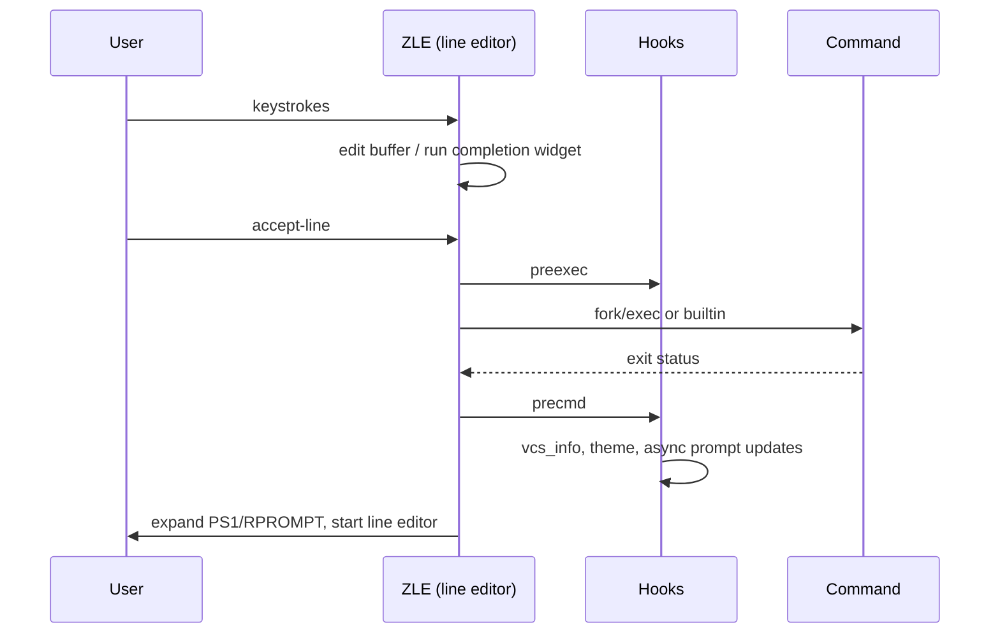
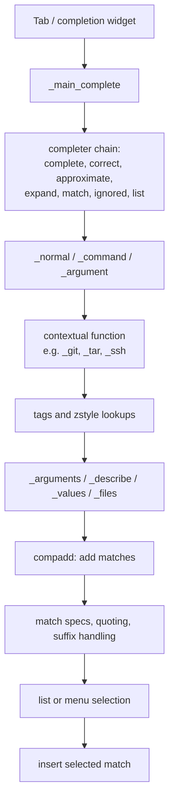
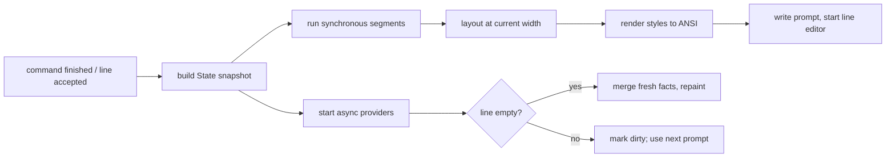
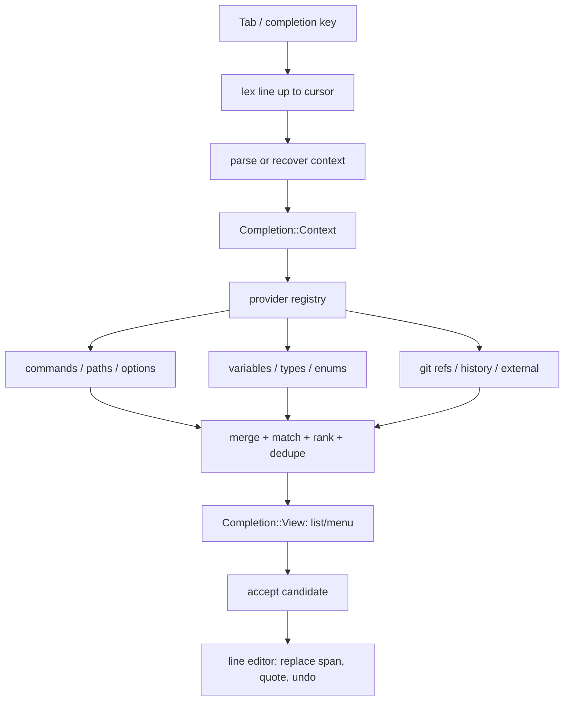

# Zsh prompts and completion

*What zsh actually does, and how Rak — a hypothetical Raku shell — could do it differently.*

## Scope, sources, and status

This note covers the two interactive subsystems a shell user touches constantly:

* the **prompt**: everything printed before the line editor accepts input;
* **completion**: the candidates offered for the word or expression under the cursor.

It is written as a design note for **Rak**, the proposed shell/language described in
`~/PLANS/rak.md` and `~/PLANS/shell.md`. Those plans sketch shell mode, naked strings,
redirections, aliases, new sigils, indentation-as-syntax, and structured pipelines. They do
not treat prompting or completion. This document fills that gap. It is a direction, not a
language specification: the Rak syntax shown here is deliberately indicative, because the
language itself is still moving.

### What was checked

| Item | Version / observation |
|---|---|
| zsh | `zsh 5.9.2 (x86_64-pc-linux-gnu)` |
| zsh manual pages | `zshmisc(1)`, `zshparam(1)`, `zshoptions(1)`, `zshcompsys(1)`, `zshcompwid(1)`, `zshzle(1)`, `zshcontrib(1)` |
| zsh function library | `/usr/share/zsh/functions`, 6.7 MB |
| completion functions | 792 files under `/usr/share/zsh/functions/Completion` |
| largest sampled completion | `_git`: 9,227 lines; 467 matching lines for `compadd`, `_arguments`, `_describe`, or `_values` |
| other samples | `_ssh` 818 lines, `_tar` 192 lines, `_curl` 7 lines (delegates to `_urls`/`_gnu_generic`) |
| compinit cost, cold scan (no dump) | 59 ms minimum, 93 ms median over 7 runs |
| compinit cost, warm dump | 8.5 ms minimum, 9.3 ms median over 7 runs |
| compinit dump size | 48,925 bytes in a fresh `ZDOTDIR` |
| baseline `zsh -f -i -c exit` | 1.9 ms minimum, 2.4 ms median over 7 runs |
| Raku | Rakudo Star 2026.08, implementing Raku v6.d on MoarVM 2026.08 |

The measurements are local, warm-cache, and only meant to establish order of magnitude. The
manual-page claims are from the installed 5.9.2 documentation; the observations about the
function corpus are from the installed tree, not from a curated distribution.

A claim marked **[Observed]** was run or read locally. A claim marked **[Inference]** follows
from the design but was not implemented or benchmarked. Unmarked statements are descriptive
facts from the cited documentation or code.

### The one-paragraph thesis

zsh's prompt is a **format string interpreted at display time**, and its completion is a
**shell program that mutates a set of string matches**. Both designs are remarkably
expressive and have produced decades of useful behavior, but both put arbitrary shell code
and global mutable state on the interactive latency path. Rak should invert the
representation: a prompt is a **typed tree of segments rendered by a width-aware layout
engine**, and completion is a **stream of typed candidates produced by providers from a
parse-derived context**. The hard part is not the data model; it is coverage. zsh has 792
completion functions and thousands of accumulated edge cases. Rak should therefore treat
zsh compatibility as a *provider*, not as the architecture, and should derive as much
completion as possible from the same command signatures that already drive dispatch.

---

## 1. The loop both subsystems live in

A shell is an event loop wrapped around a terminal. The prompt is the output edge of that
loop; completion is a special input operation inside the line editor. In zsh both are
implemented in the same process and can call arbitrary shell functions.



Important properties of the zsh arrangement:

* **`precmd` runs before every prompt**, after the previous command finishes. It is the only
  regular place to update `PS1`, `RPROMPT`, `psvar`, and `vcs_info_msg_*`.
* **`preexec` runs after a line is accepted but before execution.** It is where zsh captures
  the command text and start time for prompts that display duration.
* **Prompt expansion happens in the shell process**, not in the terminal. The terminal sees
  only the bytes and escape sequences zsh emits.
* **Completion widgets run in the line editor**, with access to the buffer, cursor, word
  array, and shell variables. A slow completion function stalls the editor exactly as a slow
  `precmd` stalls the prompt.
* **`zle -F` lets an external file descriptor wake the editor**, which is the primitive that
  asynchronous prompt implementations build on. `zle reset-prompt` then redraws.
* **The line editor owns cursor layout.** A prompt that lies about its visible width corrupts
  cursor positioning; that is why zsh has `%{...%}` and `%G`.

This is the design tension Rak must resolve: prompt and completion need shared context
(cwd, mode, parser state, command signatures, terminal width), but sharing a *mutable shell
environment* is exactly what makes zsh hard to reason about.

---

## 2. Zsh prompts

### 2.1 Parameters and options

The primary prompt is `PROMPT`, aliased to `PS1` and `prompt`. The default is `%m%# `.
Related parameters:

| Parameter | Role |
|---|---|
| `PS1` / `PROMPT` / `prompt` | primary prompt |
| `PS2` | continuation prompt; default `%_> ` |
| `PS3` | `select` loop prompt; default `?# ` |
| `PS4` | execution trace prompt; default `+%N:%i> ` |
| `RPROMPT` / `RPS1` | right-hand prompt when `PS1` is displayed |
| `RPROMPT2` / `RPS2` | right-hand prompt for the continuation prompt |
| `SPROMPT` | spelling-correction prompt; `%R` is the bad string, `%r` the correction |
| `PSVAR` / `psvar` | array whose elements are available as `%v`, `%1v`, etc. |
| `PROMPT_EOL_MARK` | mark shown for a partial line before the prompt; default `%B%S%#%s%b` |
| `ZLE_RPROMPT_INDENT` | indentation of the right prompt from the right margin |

The relevant options are:

| Option | Effect |
|---|---|
| `PROMPT_PERCENT` | expand `%` escapes |
| `PROMPT_SUBST` | perform parameter expansion, command substitution, and arithmetic expansion first |
| `PROMPT_BANG` | expand `!` to the history event number |
| `PROMPT_CR` | print a carriage return before the prompt (default on) |
| `PROMPT_SP` | preserve a partial line instead of letting the prompt overwrite it (default on) |
| `TRANSIENT_RPROMPT` | remove the right prompt when the line is accepted |
| `SINGLE_LINE_ZLE` | disables right prompts by making ZLE single-line |

`PS2` is not just a static string: `%_` expands to the parser state, meaning the shell
constructs (`if`, `for`, quotes, etc.) currently open. `%^` is the same list in reverse.
That is zsh's way of making a continuation prompt reflect the parser. Rak needs an
equivalent, but it should get the state from its real parser rather than reconstructing it
from a prompt string.

### 2.2 Prompt expansion semantics

The order matters:

1. If `PROMPT_SUBST` is set, the prompt string is first subjected to parameter expansion,
   command substitution, and arithmetic expansion.
2. If `PROMPT_BANG` is set, `!` becomes the history event number.
3. If `PROMPT_PERCENT` is set, percent escapes are expanded, recursively, including
   conditional substrings and truncation.
4. The result is written to the terminal; ZLE uses the declared zero-width regions and
   `%G` counts to decide where the cursor is.

`print -P` uses the same expansion, which makes it the standard test oracle:

```zsh
% print -P '%n@%m %~ %#'
cog@om ~/gendocs %
% print -P '%(?..%F{red}%?%f )%B%~%b'
~/gendocs
% false; print -P '%(?..%F{red}%?%f )%B%~%b'
1 ~/gendocs
% print -P '%10<..<%~%<<%#'
~/gendocs%
```

The conditional example prints nothing for the true branch when the status is zero, and
prints the status when it is non-zero; the terminal renders the `1` in red. The last
example truncates the path to ten characters with `..` as the replacement marker.

#### Common simple escapes

| Escape | Meaning |
|---|---|
| `%%` | literal `%` |
| `%)` | literal `)` |
| `%n` | username |
| `%m` / `%M` | short / full hostname |
| `%l` / `%y` | tty name |
| `%#` | `#` for privileged shell, `%` otherwise |
| `%?` | exit status of the last command |
| `%d` / `%/` | full current directory |
| `%~` | current directory with `~` and named-directory contraction |
| `%c` / `%.` / `%C` | trailing directory component(s) |
| `%j` | number of jobs |
| `%L` | `SHLVL` |
| `%h` / `%!` | history event number |
| `%_` / `%^` | parser state, forward / reverse |
| `%N` | name of the current script, sourced file, or function |
| `%i` / `%I` | line number in the current function / defining file |
| `%x` | file containing the source currently executing |
| `%e` | evaluation depth |
| `%D` | date, `yy-mm-dd` |
| `%T` | time, 24-hour |
| `%t` / `%@` | time, 12-hour am/pm |
| `%*` | time with seconds |
| `%w` | date, `day-dd` |
| `%W` | date, `mm/dd/yy` |
| `%D{format}` | `strftime` format, with zsh extensions |
| `%B` / `%b` | bold on / off |
| `%U` / `%u` | underline on / off |
| `%S` / `%s` | standout on / off |
| `%F{color}` / `%f` | foreground color / default foreground |
| `%K{color}` / `%k` | background color / default background |
| `%{...%}` | literal escape sequence with zero visible width |
| `%G` | within `%{...%}`, declare a one-cell-wide glitch |

`%D{...}` passes the format to `strftime(3)`, with zsh extensions: `%f` for day of month
without padding, `%K` for 24-hour hour without padding, `%L` for 12-hour hour without
padding, and `%.` for fractional seconds (`%3.` milliseconds, `%6.` microseconds, `%9.`
nanoseconds). The GNU `%-` zero-stripping extension is handled directly for several format
characters.

#### Conditional substrings

The general form is:

```text
%(x.true-text.false-text)
```

`x` is a test character; the character after `x` is the separator, reused between the true
and false texts. An optional integer before the test modifies it. The false text may contain
`%)` for a literal `)`, and both branches may contain nested escapes, including nested
conditionals.

Important test characters:

| Test | True when |
|---|---|
| `?` | exit status equals *n* |
| `!` | shell is privileged |
| `#` | effective uid equals *n* |
| `j` | at least *n* jobs |
| `L` | `SHLVL` is at least *n* |
| `_` | at least *n* shell constructs are open |
| `C` / `/` | absolute path has at least *n* components |
| `c` / `.` / `~` | contracted path has at least *n* components |
| `l` | at least *n* characters have been printed on the line; negative counts from the other margin |
| `v` | `psvar` has at least *n* elements |
| `V` | element *n* of `psvar` is set and non-empty |
| `D`, `d`, `T`, `t`, `w` | month, day, hour, minute, weekday equal *n* |

This is effectively a tiny, stringly-typed expression language embedded in the prompt. It is
useful, but it has no static structure, no type checking, and no way to report which branch
was taken or why a segment disappeared.

#### Truncation and width

Truncation forms:

| Form | Meaning |
|---|---|
| `%<string<` | truncate at the left; `string` replaces the removed part |
| `%>string>` | truncate at the right |
| `%[xstring]` | deprecated equivalent of `%xstringx` |
| `%n<...<` | maximum length *n* |
| `%-n<...<` | truncate so at least *n* characters remain before the opposite margin |
| `%<<` | stop truncation at this point |

Truncation runs to the end of the prompt, the end of the enclosing `%(...)`, or the next
truncation at the same grouping level. Truncation is per line; if a line still exceeds the
terminal width, or the truncated region contains newlines, behavior is undefined and may
change.

Width correctness is the sharp edge:

* `%{...%}` tells zsh that the enclosed bytes do not move the cursor.
* `%G` says "assume one cell" for a sequence that is otherwise hard to measure; `%2G` says
  two cells, and multiple `%G`s accumulate.
* Wide characters, combining marks, emoji sequences, and terminal-specific width tables can
  all invalidate the shell's model.
* A prompt that emits an escape sequence without `%{...%}` will make ZLE think the line is
  longer than it is, which breaks wrapping, cursor motion, and history recall.

The design lesson is not "make `%{...%}` easier". It is "never let the semantic layer emit
raw terminal escapes". If escapes are generated only by a renderer that also owns width,
`%{...%}` disappears as a user-facing concept.

### 2.3 Themes, `promptinit`, and `vcs_info`

`promptinit` turns prompt configuration into a theme system. A theme is a
`prompt_<name>_setup` function in `fpath`; it sets `PS1`, `PS2`, `PS3`, `RPS1`, and
registers hooks. `prompt_opts` records which prompt options the theme expects
(`bang`, `cr`, `percent`, `sp`, `subst`), so switching themes can restore the right option
set. `prompt` saves and restores the previous theme with `zstyle :prompt-theme restore`.

A typical installed theme, `prompt_adam1_setup`, shows the mechanics:

```zsh
prompt_adam1_setup () {
  setopt localoptions nowarncreateglobal
  prompt_adam1_color1=${1:-'blue'}
  prompt_adam1_color2=${2:-'cyan'}
  prompt_adam1_color3=${3:-'green'}

  base_prompt="%K{$prompt_adam1_color1}%n@%m%k "
  post_prompt="%b%f%k"

  setopt localoptions extendedglob
  base_prompt_no_color="${base_prompt//(%K{[^\\\}]#\}|%k)/}"
  post_prompt_no_color="${post_prompt//(%K{[^\\\}]#\}|%k)/}"

  add-zsh-hook precmd prompt_adam1_precmd
}

prompt_adam1_precmd () {
  setopt localoptions noxtrace nowarncreateglobal
  local base_prompt_expanded_no_color base_prompt_etc
  local prompt_length space_left
  base_prompt_expanded_no_color=$(print -P "$base_prompt_no_color")
  base_prompt_etc=$(print -P "$base_prompt%(4~|...|)%3~")
  prompt_length=${#base_prompt_etc}
  if [[ $prompt_length -lt 40 ]]; then
    path_prompt="%B%F{$prompt_adam1_color2}%(4~|...|)%3~%F{white}"
  else
    space_left=$(( $COLUMNS - $#base_prompt_expanded_no_color - 2 ))
    path_prompt="%B%F{$prompt_adam1_color3}%${space_left}<...<%~$prompt_newline%F{white}"
  fi
  PS1="$base_prompt$path_prompt %# $post_prompt"
  PS2="$base_prompt$path_prompt %_> $post_prompt"
  PS3="$base_prompt$path_prompt ?# $post_prompt"
}
```

Notice what the theme has to do to measure itself: expand the prompt with `print -P` into a
temporary string, strip color escapes with a pattern, count characters with `${#...}`, then
recompute a truncation width. The theme is not composing a value; it is simulating the
shell's own renderer in shell code.

`vcs_info` follows the same pattern. The user loads it, configures `zstyle` contexts, and
calls it from `precmd`:

```zsh
autoload -Uz vcs_info
zstyle ':vcs_info:*' enable git
zstyle ':vcs_info:*' formats '%F{5}(%f%s%F{5})%F{3}-%F{5}[%F{2}%b%F{5}]%f '
precmd () { vcs_info }
PS1='%F{5}[%F{2}%n%F{5}] %F{3}%3~ ${vcs_info_msg_0_}%f%# '
setopt prompt_subst
```

`vcs_info` supports many backends (git, hg, svn, bzr, fossil, p4, and others), style-driven
formats, action formats for merges/rebases, and `disable-patterns` to avoid running in
large repositories. The cost is synchronous: `vcs_info` runs before the prompt, so every
`git status` it invokes delays the next prompt. Implementations work around this with
caching, background jobs, `zle -F`, `zle reset-prompt`, or by using an external prompt
binary such as Starship, which renders the prompt in a separate process and therefore pays
process startup and IPC on every prompt.

### 2.4 What zsh gets right, and what it costs

**Right:**

* The prompt language is compact and expressive for the common cases.
* `RPROMPT` gives useful information without consuming a line.
* Continuation prompts (`PS2`) reflect parser state, which is essential for multi-line input.
* Themes are simple functions and can be distributed in `fpath`.
* `promptinit` can restore the previous theme and its options.
* `vcs_info` has a real backend abstraction and style system.

**Costs:**

| Cost | Consequence |
|---|---|
| Prompt is a string interpreted every time | No static validation; errors appear at runtime |
| `PROMPT_SUBST` is shell evaluation | Prompt configuration becomes an injection surface and can run arbitrary commands |
| Theme code measures its own output with `print -P` and `${#...}` | Width logic is duplicated and often wrong for Unicode |
| `precmd` is synchronous | Expensive VCS or network checks block the next prompt and therefore typing |
| Global `PS1`, `psvar`, `vcs_info_msg_*` | Themes collide; stale state leaks between prompts; hard to test in isolation |
| Escapes are mixed with text | `%{...%}` is easy to forget; escape injection is possible |
| Right prompt and truncation interact | Layout is ad hoc; overflow behavior is undefined in some cases |
| No structured state | A segment cannot say "I am stale", "I failed", or "I need 20 more columns" |

The most important critique is architectural: **the prompt is a program that prints a
string**, so the shell cannot reason about it. It cannot know which parts are cheap or
expensive, which parts are stale, which parts can shrink, or which parts are safe to
display. Rak can do better by making those properties explicit.

---

## 3. Zsh completion

### 3.1 Entry points, dispatch, and initialization

Completion in zsh is implemented by ZLE widgets. The standard widgets include
`complete-word`, `expand-or-complete`, `list-choices`, `menu-complete`,
`menu-expand-or-complete`, and `menu-select`. `compinit` redefines the completion widgets
to use compsys and autoloads the completion functions.

The dispatcher is `_main_complete`. It builds a context, chooses a completer chain, and
passes the result to one or more completers. A simplified flow:



`compinit` scans `fpath` for files with a `#compdef` first line, autoloads them, records
their command associations, and writes a dump (`.zcompdump`) so subsequent startups can
skip the full scan. `compdef` associates a function with one or more commands;
`compinstall` writes the initialization lines into the user's startup files;
`bashcompinit` provides a bash-compatible `complete`/`compgen` layer. `compinit` also
performs a security audit: completion files and directories must be owned by root or the
current user and must not be world- or group-writable. The audit exists because completion
functions are arbitrary shell code that runs on Tab.

The measured startup cost on this machine is significant but not catastrophic: a cold
`compinit` took 59–93 ms, while a warm dump took 8.5–9.3 ms, against a 1.9–2.4 ms baseline
interactive zsh startup. That is the price of a 792-function completion corpus and a
6.7 MB function tree. It is a useful warning for Rak: a powerful completion system has a
startup and memory cost, and that cost should be paid lazily, not on every shell start.

### 3.2 Context, tags, and styles

The context string is the central abstraction. It has six colon-separated fields:

```text
:completion:function:completer:command:argument:tag
```

For example:

```text
:completion::complete:dvips:option-o-1:files
```

means: normal completion, no special function, the `complete` completer, the `dvips`
command, the first argument to `-o`, and the `files` tag.

* **Tags** classify the kind of object being completed: `commands`, `files`, `directories`,
  `options`, `hosts`, `jobs`, `processes`, `parameters`, `arrays`, `association-keys`,
  `signals`, `time-zones`, and many more.
* **Styles** configure behavior: `menu`, `list`, `verbose`, `tag-order`, `matcher-list`,
  `file-patterns`, `ignored-patterns`, `hosts`, `users-hosts`, and so on.
* **Style lookup** matches the most specific context pattern. `:completion:*` applies
  broadly; `:completion:*:*:kill:*:jobs` applies only to job matches for `kill`.

This is a genuinely good idea: separate *what the candidates are* (tags) from *how to
present and order them* (styles). Rak should keep the separation, but replace the stringly
context and `zstyle` triples with typed context records and validated configuration.

### 3.3 `_arguments`: a command-line parser embedded in shell

`_arguments` is the workhorse for commands with conventional options. It is a declarative
DSL, but it is interpreted as shell code and its actions can execute arbitrary commands.

A simplified spec:

```zsh
_arguments -s \
  '(-v --verbose)'{-v,--verbose}'[increase verbosity]' \
  '--format=[output format]:format:(json yaml text)' \
  '1:input file:_files' \
  '*:extra files:_files'
```

The spec forms:

| Form | Meaning |
|---|---|
| `n:message:action` | the *n*th normal argument |
| `n::message:action` | the *n*th normal argument, optional |
| `:message:action` | the next normal argument |
| `::message:action` | the next normal argument, optional |
| `*:message:action` | all remaining normal arguments |
| `*::message:action` | remaining arguments, with `words`/`CURRENT` restricted |
| `*:::message:action` | remaining arguments covered by the description |
| `-optname` | option; first argument follows in the next word |
| `-optname-` | first argument must be attached in the same word |
| `-optname+` | argument may be attached or separate |
| `-optname=` | argument may be separate or after `=` |
| `-optname=-` | argument must be after `=` in the same word |
| `optspec[explanation]` | explanatory text for the option |
| `:message:action` after an optspec | an argument to the option |
| `:*pattern:message:action` | multiple option arguments, up to a pattern |
| `(exclusions)optspec` | options/arguments excluded when this one is present |
| `!optspec` | skip the form when parsing but do not complete it |
| `->state` | return control to the caller with `$state` set |

Options to `_arguments` itself include:

| Option | Effect |
|---|---|
| `-s` | enable stacking of single-letter options (`-xy`) |
| `-w` | allow stacking even when one of the options takes an argument |
| `-W` | complete single-letter options after an attached argument |
| `-S` | do not complete options after `--`; ignore the `--` |
| `-A pattern` | stop completing options after the first non-option argument; `pattern` names strings not treated as arguments |
| `-O name` | pass the elements of an array to action functions |
| `-n` | set `NORMARG` to the first normal argument position |
| `-R` | return status 300 instead of zero for `->state` actions |
| `-M matchspec` | match specification for option names and values |

Actions can be:

| Action | Meaning |
|---|---|
| `(item1 item2 ...)` | literal candidates |
| `((item1\:desc1 ...))` | literal candidates with descriptions |
| `->string` | set `$state` and return to the caller |
| `{shell code}` | evaluate shell code to generate matches |
| `function args` | call a function to generate matches |
| a single space | show the message but do not generate matches |

The `->state` mechanism is effectively a hand-written state machine. The caller declares
`context`, `state`, `state_descr`, `line`, and `opt_args`, then loops while `_arguments`
returns status 300. This is flexible, but it is a parser implemented as control flow inside
shell functions, with the command line, option state, and match state held in global
variables.

`_arguments --` can derive spec forms from a command's `--help` output. `_gnu_generic` is
the minimal version:

```zsh
_arguments '*:arg: _default' --
```

`_curl` delegates to `_urls` or `_gnu_generic`; `_git` is 9,227 lines because it encodes a
large command tree, option grammar, refs, remotes, and state-dependent behavior.

### 3.4 `compadd` and the match model

`compadd` adds matches and controls how they are displayed and inserted. Every match is
broken into seven fields:

```text
<ipre><apre><hpre><body><hsuf><asuf><isuf>
```

| Field | Source | Meaning |
|---|---|---|
| `ipre` | `IPREFIX` plus `-i` | ignored prefix from the command line |
| `apre` | `-P` | prefix inserted before the match, not part of the match |
| `hpre` | `-p` | hidden prefix, inserted but not listed |
| `body` | the completion text | what the user sees |
| `hsuf` | `-s` | hidden suffix |
| `asuf` | `-S` | suffix inserted after the match |
| `isuf` | `-I` | ignored suffix |

Useful flags:

| Flag | Effect |
|---|---|
| `-d array` | per-match display strings |
| `-l` | list display strings one per line |
| `-J group` | sorted group name |
| `-V group` | unsorted group name |
| `-X explanation` | explanation printed above the group |
| `-x message` | message printed even with no matches |
| `-P prefix` / `-S suffix` | inserted prefix/suffix |
| `-p hidden-prefix` / `-s hidden-suffix` | hidden prefix/suffix |
| `-q` | remove suffix if the next typed character is blank or does not insert |
| `-r chars` | remove suffix when one of the characters is typed |
| `-R func` | call a function after the next character to remove a suffix |
| `-f` | mark matches as files; add `/` for directories |
| `-M matchspec` | local match specification |
| `-U` | do not match; add all completions |
| `-O array` | store matching completions instead of adding them |
| `-A array` | store internally generated strings instead of the originals |
| `-n` | add matches but do not list them |
| `-C` | add a special match that expands to all other matches |
| `-E number` | add empty matches for formatting |

The special parameters `PREFIX`, `SUFFIX`, `IPREFIX`, `ISUFFIX`, `QIPREFIX`, `QISUFFIX`,
`words`, and `CURRENT` describe the current word and quoting state. `compset` moves text
between these fields so that completion functions can ignore syntactic prefixes (`--opt=`)
without losing them on insertion.

`compstate` is an associative array used to exchange state with the completion code. Keys
include `context`, `insert`, `list`, `nmatches`, `exact`, `exact_string`, `unambiguous`,
`unambiguous_cursor`, `quote`, `quoting`, `redirect`, `parameter`, `pattern_match`,
`restore`, `to_end`, `last_prompt`, and `old_list`. A completion function can set
`compstate[insert]` to `menu`, `automenu`, `unambiguous`, or a match number; set
`compstate[list]` to force or suppress listing; and read `compstate[unambiguous]` to see the
common prefix.

This is the string-matching core. It is powerful, but note what is missing: there is no
notion of a candidate's *type*, *source*, *cost*, *freshness*, *confidence*, or *semantic
validity*. A candidate is a string plus display metadata plus insertion metadata.

### 3.5 Sources, utilities, and bindable commands

The completion corpus covers an enormous range of sources:

* files, directories, globbed files, path prefixes;
* external commands, builtins, functions, aliases;
* options, subcommands, operands;
* parameters, arrays, associative-array keys, subscripts;
* jobs, PIDs, signals, users, groups, hosts, services;
* modules, packages, printers, time zones, URLs, git refs, and more.

Important utility functions:

| Function | Role |
|---|---|
| `_files` / `_path_files` | file and directory completion |
| `_describe` | list candidates with descriptions |
| `_values` | complete a list of values separated by a delimiter |
| `_alternative` | try alternative sources in order |
| `_wanted` / `_requested` | tag-aware candidate generation |
| `_guard` | conditionally apply a completion |
| `_message` | display a message instead of candidates |
| `_call_program` | run a command to obtain candidates |
| `_pick_variant` | choose between command variants |
| `_regex_arguments` | parse a command line with a regular-expression grammar |
| `_arguments` | conventional option/operand grammar |

Bindable commands provide diagnostics and alternate completion modes:

| Command | Role |
|---|---|
| `_complete_help` | show contexts, tags, and functions used at the cursor |
| `_next_tags` | cycle through tag sets |
| `_read_comp` | prompt for a completion function or `compadd` arguments |
| `_complete_debug` | capture a trace of completion execution |
| `_correct_word` | spelling-correct the current word |
| `_expand_word` | expand the current word using the `_expand` completer |

Menu and listing behavior is controlled by options such as `AUTO_LIST`,
`LIST_AMBIGUOUS`, `LIST_PACKED`, `LIST_ROWS_FIRST`, `MENU_COMPLETE`, and `AUTO_MENU`, plus
styles like `menu` and `list`. `menu-select` turns the completion list into a selectable
menu.

### 3.6 What zsh gets right, and what it costs

**Right:**

* Context is explicit enough to distinguish command, argument, option, redirect, subscript,
  and many other positions.
* Tags separate candidate classification from presentation policy.
* `_arguments` is a compact, reusable CLI grammar for the common case.
* The corpus is enormous and battle-tested; 792 functions cover tools most users never
  think about.
* `compadd` gives fine-grained control over insertion, quoting, suffixes, and display.
* Menu selection, correction, approximate matching, and `_next_tags` provide a mature UX.
* `bashcompinit` and `compctl` compatibility show that completion can be layered.

**Costs:**

| Cost | Consequence |
|---|---|
| Completion is shell code | Any function can run arbitrary commands, mutate state, or block |
| Definitions duplicate the CLI | The completion for `foo` drifts from `foo`'s actual parser |
| `_arguments` is a string DSL | No type checking; actions are shell fragments; hard to test |
| Candidate is a string | No type, provenance, cost, confidence, or semantic validation |
| Global special parameters | Functions interfere with each other; `compset` is needed to repair state |
| Per-keystroke interpretation | Complex functions are slow; the corpus is large; startup costs matter |
| Security relies on file ownership | A writable completion directory is a code-execution vector |
| Insertion is string-based | Quoting and suffix rules are subtle; control characters can leak to the terminal |
| Coverage is zsh-specific | Reusing it outside zsh is hard; porting is impractical |

The deep critique: **zsh completion is a search over a mutable set of strings, driven by
shell code**. It has no representation of *why* a candidate is valid or *how expensive* it
was to find. That is why `_complete_help` and `_complete_debug` exist: the system is hard to
inspect from the outside.

---

## 4. What Rak should copy, and what it should invert

Rak's plans already imply a different foundation:

* `~/PLANS/rak.md`: shell mode and standard mode in one language; naked strings;
  redirections; aliases; new sigils; concision; interactivity as a learning surface.
* `~/PLANS/shell.md`: Rak as a fork of Rakudo; structured pipelines; terminal history;
  charmbracelet as a terminal-UI library stack.
* `~/PLANS/indentation-as-syntax.md`: indentation as block syntax, so the parser must track
  indentation and continuation state.
* `~/PLANS/subscripting.md`: `.`-based subscripts, sigils that imply types, and less noisy
  data access.
* `~/PLANS/yaml-matcher.md`: structured data, web redirection, and myaml matching.

None of these settle prompt or completion, but they constrain the design:

1. **Two modes.** Completion and continuation prompts must know whether the line is being
   parsed as shell mode or standard Rak. A single stringly prompt cannot express that.
2. **Naked strings.** Word splitting and quoting are not POSIX; completion must use Rak's
   own lexer, not `sh` word rules.
3. **Indentation.** Continuation prompts must reflect indentation blocks and tree
   expressions, not just open parentheses.
4. **Typed data.** Rak already wants structured pipelines and typed values. Completion
   candidates and prompt state should be structured too.
5. **Interactive performance.** Rak is a full language on MoarVM; it cannot afford to spawn
   a fresh interpreter or run a compiler per keystroke.

The recommendation is to copy zsh's **separation of concerns** (context, tags, styles,
completers, sources) and reject its **representation** (strings, shell code, global state,
synchronous hooks).

| Concern | zsh | Rak proposal |
|---|---|---|
| Prompt representation | format string expanded by the shell | typed segment tree + renderer |
| Prompt state | global variables, `PS1`, `psvar` | immutable `Prompt::State` snapshot |
| Prompt extensibility | shell functions in `fpath` | `Prompt::Provider` values with declared cost/cache |
| Prompt width | `%{...%}`, `%G`, manual arithmetic | renderer owns width; semantic runs have no escapes |
| Prompt updates | synchronous `precmd` | sync cheap facts + async providers + stale cache |
| Completion context | colon-separated string | typed `Completion::Context` derived from lexer/parser |
| Completion grammar | `_arguments` string DSL | `CommandSpec` derived from signatures or declarative data |
| Completion candidates | strings + display/insertion metadata | typed `Candidate` values with provenance and spans |
| Completion sources | autoloaded shell functions | `Completion::Provider` streams |
| Completion policy | `zstyle` strings | typed config with validated keys |
| Coverage | 792 hand-written functions | native specs + generated specs + optional zsh bridge |
| Security | fpath ownership audit | no eval; data-first; external providers opt-in |

### Design invariants

These invariants are worth making explicit because they drive most of the API:

1. **No shell evaluation on the interactive path.** Prompt rendering and completion must
   not `EVAL` user strings, call `sh -c`, or expand arbitrary code. Code providers are
   explicit plugins, not configurations.
2. **The prompt is pure given `(state, width, capabilities)`.** Providers may fetch facts,
   but the renderer is deterministic. This makes golden tests possible.
3. **Completion never mutates shell state.** It reads a snapshot and returns candidates; the
   only mutations are to the line buffer and undo history when a candidate is accepted.
4. **Every candidate has a provenance and an insertion span.** No candidate is just a
   string. This is what enables ranking, deduplication, diagnostics, and safe quoting.
5. **All external text is untrusted.** Filenames, command descriptions, VCS output, and
   external provider output are sanitized before reaching the terminal.
6. **Latency is enforced, not hoped for.** Every provider has a timeout; every prompt
   segment has a budget; stale data is allowed, blocking is not.
7. **Fail open.** A failed provider yields no candidates plus a diagnostic; it does not
   prevent editing or executing the line.
8. **The parser is the source of truth.** Completion contexts and continuation prompts
   should come from the same lexer/parser that executes the line, with a tolerant fallback.
9. **Compatibility is a provider.** zsh completion and prompt strings can be imported, but
   they do not define the core model.
10. **Width and Unicode are core.** They are not a theme's problem.

---

## 5. A prompt architecture for Rak

### 5.1 Module layout

A proposed layout (`.rakumod` for library modules, `.rak` for user scripts):

```text
lib/Rak/Interactive/Terminal.rakumod        # raw mode, size, capabilities, ANSI
lib/Rak/Interactive/LineEditor.rakumod      # buffer, cursor, keymap, widgets
lib/Rak/Interactive/Prompt.rakumod          # State, Segment, Layout, Renderer
lib/Rak/Interactive/Prompt/Provider.rakumod # async facts
lib/Rak/Interactive/Prompt/Theme.rakumod    # theme loading and validation
lib/Rak/Interactive/Completion.rakumod      # Context, Candidate, Session
lib/Rak/Interactive/Completion/Lexer.rakumod
lib/Rak/Interactive/Completion/Spec.rakumod
lib/Rak/Interactive/Completion/Provider.rakumod
lib/Rak/Interactive/Completion/View.rakumod
lib/Rak/Interactive/Completion/Import/Zsh.rakumod
```

The important boundary is `Terminal`: prompt, line editor, and completion all need to know
the same terminal size, capability set, and cursor state. They should share one terminal
object, not each own a private idea of whether the terminal supports 256 colors.

Existing readline-style libraries are not a sufficient foundation for a zsh-class editor:
they own the prompt and the completion callback model, which conflicts with asynchronous
prompt segments and a typed candidate view. Use them, if at all, as a fallback for dumb
terminals or non-interactive testing. The primary editor should be a Rak state machine over
key events. This is an [Inference] from the required features, not a measured comparison.

### 5.2 Core types

The following is Rak-flavored sketch code, not a claim that these exact names or signatures
exist.

```rak
unit module Rak::Interactive::Prompt;

enum StyleMode is export <plain ansi16 ansi256 truecolor>;

class Run is export {
    has Str $.text is required;
    has %.style;          # fg, bg, bold, dim, italic, underline, reverse
    has Bool $.untrusted = False;
}

class State is export {
    has IO::Path $.cwd;
    has IO::Path $.home;
    has Str $.user;
    has Str $.host;
    has Int $.exit-code;
    has Duration $.duration;
    has Str $.last-command;
    has Int $.job-count;
    has Instant $.now;
    has Str $.mode;             # normal, shell, continuation, search
    has Str $.parser-state;     # open blocks, quotes, heredocs, ...
    has Int $.cols;
    has Int $.rows;
    has %.facts;                # typed provider results + freshness
}

role Segment is export {
    method name(--> Str) { ... }
    method priority(--> Int) { 0 }
    method sync(--> Bool) { True }
    method timeout(--> Duration) { 100ms }
    method cache-ttl(--> Duration) { 0 }
    method visible(State $s --> Bool) { True }
    method render(State $s --> List) { ... }       # List of Run
    method refresh(State $s --> Promise) { ... }   # optional async fact fetch
}

class TextSegment does Segment is export {
    has Str $.text;
    has %.style;
    method render(State $s --> List) {
        (Run.new(:text($.text), :style(%!style)),)
    }
}

class ProviderSegment does Segment is export {
    has Str $.provider-name;
    has &.formatter;
    has Bool $.async = False;
    method sync(--> Bool) { !$.async }
    method refresh(State $s --> Promise) { ... }
    method render(State $s --> List) { ... }
}
```

`State` is a snapshot, not a live shell object. `%facts` maps provider names to values plus
metadata (`value`, `fetched-at`, `ttl`, `error`, `source`). Segments declare what they need;
the scheduler resolves it. This is the key difference from `precmd`: a segment cannot
silently mutate `PS1` or run arbitrary code in the middle of rendering.

### 5.3 Render pipeline



Steps:

1. **Snapshot cheap state.** CWD, user, host, exit code, duration, job count, time, parser
   state, terminal size. This should be microseconds, not milliseconds.
2. **Render synchronous segments.** These are values the shell already has. No subprocesses.
3. **Layout and emit.** Compute visible widths, place right segments, shrink/truncate, emit
   SGR sequences through the renderer.
4. **Start async providers.** Git status, Kubernetes context, cloud account, battery,
   network, language versions, etc. Each has a deadline and a cache entry.
5. **Repaint only when safe.** If the line editor buffer is empty and no completion menu is
   visible, merge results and repaint. If the user is typing, store the result for the next
   prompt. Never move the cursor out from under the user.
6. **Mark staleness.** If a cached fact is older than its TTL, keep showing it (stale but
   useful) and optionally render a subtle marker. Do not blank the segment just because a
   refresh is in flight.

This is the "stale-while-revalidate" model that good asynchronous prompts approximate with
`zle -F` and `reset-prompt`. Rak can make it a first-class scheduler instead of a collection
of shell hacks.

### 5.4 Layout and width

The renderer owns width. A `Run` contains text and semantic style, never raw escapes. The
renderer converts styles to escapes and knows that those escapes occupy zero cells.

A layout algorithm:

```text
render(prompt, cols):
    left  = render segments in order, skipping invisible ones
    right = render right segments in order

    while width(left) + min-gap + width(right) > cols:
        drop the lowest-priority right segment
        if no right segments remain: break

    if width(left) + min-gap + width(right) <= cols:
        pad = cols - width(left) - width(right)
        emit left + spaces(pad) + right
    else:
        left = shrink(left, cols)
        if width(left) > cols:
            wrap to a second line using continuation indent
        emit left
```

`shrink` needs per-segment policy:

| Policy | Behavior |
|---|---|
| `truncate-left` | keep the tail of a path, prefix with `…` or `...` |
| `truncate-right` | keep the head, suffix with `…` |
| `shorten` | replace a known prefix (`$HOME`, repo root) |
| `drop` | remove the segment if it does not fit |
| `wrap` | allow a second prompt line with an indent |
| `fixed` | never shrink; may force wrapping or overflow |

The default path segment should be `truncate-left` with a configurable minimum width.
`user@host` should be `drop` or `shorten` at narrow widths. The right prompt should be the
first thing to disappear, not the thing that pushes the left prompt off-screen.

Width rules:

* Count **grapheme clusters**, not bytes and not code points. A combining sequence is one
  cell; an emoji ZWJ sequence may be one or two cells depending on the terminal.
* Use `wcwidth`-style East Asian width for ambiguous characters; expose a config knob for
  "ambiguous = 1" vs "ambiguous = 2" because terminals differ.
* Treat control characters as zero-width *only* if the renderer emitted them; untrusted
  text must be escaped before measurement.
* Never measure ANSI escapes. Since semantic runs contain none, measurement is just text.
* If a terminal reports a width that differs from the local table, prefer the terminal's
  `TIOCGWINSZ` columns for layout but keep the local table for cell widths.

`TIOCGWINSZ` requires an `ioctl` on the terminal; Raku can call it with `NativeCall`, or a
small helper can expose it. The exact mechanism is less important than having one
`Terminal` object that owns the answer and emits a resize event.

### 5.5 Async providers and caching

Provider contract:

```rak
role Prompt::Provider is export {
    method name(--> Str) { ... }
    method cache-key(State $s --> Str) { ... }
    method ttl(--> Duration) { 5s }
    method deadline(--> Duration) { 200ms }
    method fetch(State $s --> Promise) { ... }
}
```

Scheduling rules:

* **Per-prompt generation ID.** Late results from an old prompt are discarded.
* **Per-provider cancellation token.** A new prompt cancels in-flight work that is no
  longer relevant. The provider must terminate child processes, not just abandon a promise.
* **Deadline.** A provider that misses its deadline is marked failed/stale; the prompt does
  not wait.
* **Cache key.** Include everything that changes the result: CWD, repo root, `.git/HEAD`
  and index mtimes, environment variables that matter, command version. A cache keyed only
  on CWD will show the wrong branch after a checkout.
* **Stale value.** Keep the last good value and its timestamp. Render it while refreshing.
* **Bounded output.** Providers that run external commands must cap bytes and lines; a
  malicious or broken command must not fill memory.

Git example:

```rak
class Prompt::Provider::Git does Prompt::Provider {
    method name(--> Str) { 'git' }
    method cache-key(State $s --> Str) {
        my $root = find-git-root($s.cwd);
        return '' unless $root;
        ~ ($root, (($root ~ '/.git/HEAD').IO.modified // 0),
                 (($root ~ '/.git/index').IO.modified // 0));
    }
    method fetch(State $s --> Promise) {
        start {
            my $root = find-git-root($s.cwd);
            return %() unless $root;
            my $p = Proc::Async.new('git', '-C', $root, 'status',
                                    '--porcelain=v2', '--branch');
            # capture with a timeout; parse branch, ahead/behind, dirty count
            ...
        }
    }
}
```

For the first prompt in a repository, show the branch from a cheap read of
`.git/HEAD` if possible, and let the async `git status` fill in dirty/ahead/behind. That
keeps the prompt responsive even on a cold cache.

### 5.6 Theme and configuration model

The default should be **data**, not code:

```yaml
# ~/.config/rak/prompt.yaml
theme: compact
segments:
  - name: user
    priority: 20
    format: "{user}@{host}"
  - name: path
    priority: 30
    shrink: truncate-left
    min_width: 12
  - name: git
    priority: 40
    async: true
    ttl: 5s
    format: "{branch}{dirty}"
  - name: status
    priority: 10
    format: "{exit_code}"
    when: "exit_code != 0"
right:
  - name: duration
    priority: 5
    when: "duration > 2s"
```

Templates such as `{branch}{dirty}` interpolate named fields only; they are compiled and
validated at load time, not `EVAL`'d. Conditions are parsed into a restricted predicate
language (field comparisons, duration literals, boolean combinators), so a condition such
as `when: "exit_code != 0"` is data, not arbitrary Rak code. If a condition needs real
computation, it belongs in a provider.

A code provider is allowed, but it must be declared as code and loaded from a trusted
path:

```rak
# ~/.config/rak/prompt/providers/git.rak
class MyGit does Prompt::Provider {
    method fetch(Prompt::State $s --> Promise) { ... }
}

register-prompt-provider(MyGit.new);
```

This avoids the zsh situation where a theme can do anything during prompt expansion, while
still allowing users to write providers in Rak. The config is validated at load time; an
unknown key or a cycle in segment dependencies is a startup error, not a mysterious blank
prompt.

### 5.7 Importing zsh prompts

A migration path matters more than a perfect one. `rak prompt import-zsh` can parse a
`PS1`/`RPROMPT` string into segments:

| zsh construct | Rak import |
|---|---|
| literal text | `TextSegment` |
| `%n`, `%m`, `%M`, `%~`, `%d`, `%#` | built-in state segments |
| `%F{color}`, `%K{color}`, `%B`, `%U`, `%S` | style runs on nearby text |
| `%?`, `%j`, `%L`, `%h` | state segments |
| `%D{format}` | `TimeSegment` with a `strftime`-compatible format |
| `%{...%}` | raw escape segment, only with `allow-raw-escapes` and an explicit width |
| `%(x.true.false)` | `ConditionalSegment` with a typed predicate where possible |
| `%<...<` | `TruncateSegment` |
| `${vcs_info_msg_0_}` | `GitSegment` if the corresponding provider is configured; otherwise diagnostic |
| `PROMPT_SUBST` with command substitution | rejected, with an explanation |

The importer should produce a report:

```text
imported: 14 segments
unsupported: 2
  - %{...%} raw escape at column 23 (requires allow-raw-escapes)
  - ${...} command substitution at column 41 (PROMPT_SUBST unsupported)
```

This is more honest than silently rendering a partially correct prompt.

### 5.8 Continuation, transient, and mode-aware prompts

`State.mode` and `State.parser-state` drive the continuation prompt:

* `normal`: primary prompt.
* `shell`: primary prompt with a shell-mode indicator (the exact glyph is a theme choice).
* `continuation`: prompt shown when the parser needs more input; includes open construct
  names and indentation.
* `search`: history search or completion filter mode.
* `completion`: menu is visible; prompt may be dimmed or shortened.

`parser-state` should be a structured list, not a string:

```rak
class ParserState {
    has Str @.open-blocks;      # if, for, sub, class, ...
    has Str @.open-quotes;      # single, double, heredoc id
    has Int $.indent;
    has Bool $.tree-expr;
    has Str $.heredoc-id;
}
```

This is where Rak can be visibly better than zsh: a continuation prompt can say
`if / for / ...` and show the expected indentation. It can also distinguish "waiting for a
closing brace" from "waiting for the right-hand side of a tree expression".

Transient prompt: after `accept-line`, replace the prompt with a compact form before the
command output scrolls. This preserves context in scrollback without repeating the full
prompt on every command. The mechanism is a `Prompt::Transient` renderer with a shorter
segment set and no right prompt. It must be optional and must not alter the command's
stdout/stderr.

### 5.9 Diagnostics

`rak prompt doctor` should answer the questions zsh users cannot easily answer:

| Column | Meaning |
|---|---|
| segment | name |
| kind | sync/async/provider |
| render | last render time |
| fetch | last provider fetch time |
| cache | hit/miss/stale |
| width | visible width at current size |
| status | ok/timeout/error |
| age | age of the cached fact |

Also useful:

* `rak prompt preview --cols 40,80,120 --theme compact`: render at several widths.
* `rak prompt explain`: show the layout decisions ("dropped right segment `duration`
  because left width 73 + gap 2 + right width 8 > 80").
* `rak prompt bench`: synthetic states and percentile timings.

This turns prompt debugging from "stare at `PS1`" into a measurable process.

### 5.10 Security and robustness

Prompt security is usually discussed only in terms of `PROMPT_SUBST`, but it is broader:

* **No prompt evaluation.** `PROMPT_SUBST`-style expansion is not supported. Imported
  strings that require it are rejected with a diagnostic.
* **No raw escapes from untrusted text.** Filenames, branch names, hostnames, and provider
  output can contain ESC, CSI, OSC, newlines, and bidi controls. Escape them visibly.
* **Cap lengths.** A 1 MB branch name should not be rendered; truncate with a marker.
* **Validate config.** Unknown keys, wrong types, and impossible layouts fail at load.
* **Isolate providers.** External commands run with a timeout and output cap; child process
  groups are killed on cancellation.
* **No terminal queries without a fallback.** Some terminals do not answer OSC/DA queries;
  prompt startup must not hang waiting for a reply.

### 5.11 Latency budget

These are targets, not measurements:

| Operation | Target | Rationale |
|---|---|---|
| State snapshot (cheap) | < 0.5 ms p99 | prompt should appear immediately |
| Sync segment rendering | < 2 ms p99 | no subprocesses, no filesystem walks |
| Layout + ANSI emission | < 1 ms p99 | width computation is linear in prompt length |
| Prompt first paint | < 5 ms p99 | human perception of "instant" |
| Async provider typical | < 50 ms | git status on a small repo |
| Async provider deadline | 200 ms | beyond this, show stale data |
| Repaint after async | < 2 ms | only when line is empty |

The prompt should never wait for an async provider. If the user starts typing before git
returns, the prompt stays as-is.

---

## 6. A completion architecture for Rak

### 6.1 The pipeline



The pipeline is intentionally split at the `Context` boundary. Context derivation is the
hard, parser-dependent part; providers are independent and can be tested with synthetic
contexts. The view and insertion logic are shared by all providers.

### 6.2 Core types

```rak
unit module Rak::Interactive::Completion;

class Context is export {
    has Str $.line;
    has Int $.cursor;
    has Str @.words;
    has Int $.current-word;
    has Str $.mode;             # shell, standard, continuation
    has Str $.kind;             # command, option, option-value, operand, path, ...
    has Str $.command;
    has Int $.arg-index;
    has Str $.option;
    has Str $.quote;            # none, single, double, backslash
    has $.ast;                  # parsed node when available
    has %.scope;                # visible variables/types, if known
    has IO::Path $.cwd;
    has %.env;
    has Str @.diagnostics;
}

class Candidate is export {
    has Str $.value is required;
    has Str $.display;
    has Str $.description;
    has Str $.kind;             # command, option, path, ref, ...
    has Str $.source;           # provider id
    has Str $.insert;
    has Int $.replace-start;
    has Int $.replace-end;
    has Str $.suffix;
    has Bool $.nospace = False;
    has Numeric $.score = 0;
    has %.meta;
}

role Provider is export {
    method id(--> Str) { ... }
    method priority(--> Int) { 50 }
    method applies(Context $ctx --> Bool) { True }
    method cache-key(Context $ctx --> Str) { '' }
    method complete(Context $ctx --> Supply) { ... }
}
```

`Candidate.value` is the semantic value; `insert` is what goes into the buffer; `display`
is what the user sees; `replace-start`/`replace-end` identify the span to replace. This
separation is essential for quoting and for candidates whose display differs from insertion
(e.g. a path with spaces, or an option with an attached value).

For the line `cat /tmp/a` (cursor after `a`), a path candidate might be:

```rak
Candidate.new(
    value         => '/tmp/a b',
    display       => 'a b',
    insert        => '/tmp/a\ b',
    replace-start => 4,
    replace-end   => 10,
    kind          => 'path',
    source        => 'paths',
);
```

The renderer shows `a b`; the editor replaces the grapheme span 4–10 with the escaped path.
If the candidate were accepted inside a double-quoted Rak string, the quote policy would
choose a different `insert` string; the semantic value stays the same.

### 6.3 Context derivation

Completion is only as good as its idea of "where am I?". The context derivation has three
layers:

1. **Lexing.** A tolerant lexer that never throws on incomplete input. It produces tokens
   with spans, quote state, and mode.
2. **Parsing.** If the token stream can be parsed, use the AST. If not, use the last
   complete token and the current token to infer context. The parser must have a completion
   mode that accepts a cursor inside an incomplete construct.
3. **Heuristics.** For external shell commands, a small shell-command grammar is enough:
   command, options, operands, redirections, pipelines.

A token model:

```rak
class Token is export {
    has Str $.type;          # word, string, operator, redirect, comment
    has Str $.text;
    has Int $.start;
    has Int $.end;
    has Str $.quote;         # none, single, double, backslash
    has Bool $.incomplete;   # token touches the cursor or an unterminated quote
}
```

Lexer states:

| State | Recognizes |
|---|---|
| `command` | start of a command, after `|`, `;`, `&&`, `||`, `(`, newline |
| `word` | naked string or identifier; backslash escapes |
| `single` / `double` | quoted string; interpolation rules differ |
| `dollar` | variable sigil or expression |
| `subscript` | `.`-sugar, `[]`, `{}` |
| `redirect` | `<`, `>`, `>>`, `2>`, URL redirection forms |
| `comment` | `#` with the Rak rule for sigil vs comment |
| `heredoc` | pending terminator |
| `indent` | indentation block state for continuation |

The context kinds should be explicit and extensible:

| Kind | Example | Typical providers |
|---|---|---|
| `command` | `gi<Tab>` | commands, aliases, functions, builtins |
| `subcommand` | `git ch<Tab>` | command spec subcommands |
| `option` | `git --<Tab>` | command spec options |
| `option-value` | `--format=<Tab>` | option value provider |
| `operand` | `git checkout <Tab>` | refs, paths, spec operands |
| `path` | `cat src/<Tab>` | filesystem |
| `redirect` | `> <Tab>` | paths, URLs |
| `variable` | `$<Tab>`, `~<Tab>`? | lexical/global variables |
| `subscript` | `@a.<Tab>` | hash keys, array indices |
| `method` | `$obj.-><Tab>` | metamodel methods |
| `type` | `my <Tab>` | types |
| `module` | `use <Tab>` | CompUnit repositories |
| `job` / `pid` | `kill <Tab>` | jobs, processes |
| `history` | `!<Tab>` | history |
| `block` | after `if` + newline | statement keywords, indentation |

The parser integration is the long-term bet. A separate lexer is acceptable for the first
milestone, but it will drift from Rak's real grammar, especially with naked strings,
tree expressions, and indentation. The compiler should eventually expose a
`CompletionContext` API from the grammar: rules annotate the context they expect
(`command`, `operand`, `option-value`, `subscript`), and the parser returns the innermost
context at the cursor plus recovery diagnostics. That is the only way to keep completion
consistent with execution.

Incremental parsing matters. On each keystroke:

* lex from the last unchanged token, not from column zero;
* reuse the previous parse if the edit is inside the current word;
* invalidate from the edit point when an operator, quote, or newline changes structure;
* cap work by a time budget (e.g. 2 ms) and fall back to lexical context.

### 6.4 Command specs and signature introspection

The biggest reuse opportunity in Rak is that a command already has a signature. Raku's
`MAIN` introspection is real:

```rak
sub MAIN(
    Bool :$verbose,
    Str :$format = 'text',
    IO::Path :$output,
    *@files,
) { ... }
```

`&MAIN.signature.params` exposes `name`, `named`, `type`, `optional`, `slurpy`, `default`,
and `constraints`; `&MAIN.candidates` exposes the candidates of a `multi MAIN`. That is
enough to derive a useful `CommandSpec`:

```rak
class OptionSpec is export {
    has Str @.names;            # <-v --verbose>
    has Str $.description;
    has Str $.argument;         # none, required, optional
    has Provider $.provider;
    has Bool $.repeatable = False;
}

class OperandSpec is export {
    has Str $.name;
    has Bool $.slurpy = False;
    has Provider $.provider;
}

class CommandSpec is export {
    has Str $.name;
    has Str @.aliases;
    has Str $.description;
    has OptionSpec @.options;
    has OperandSpec @.operands;
    has CommandSpec %.subcommands;
}
```

A sketch of the derivation:

```rak
sub spec-from-main(Str $name, &main --> CommandSpec) {
    my CommandSpec $spec .= new(:$name);
    for &main.candidates -> &candidate {
        for &candidate.signature.params -> $p {
            if $p.named {
                $spec.add-option(OptionSpec.new(
                    names       => ('--' ~ $p.name,),
                    description => ($p.WHY // ''),
                    argument    => $p.type ~~ Bool ?? 'none' !! 'required',
                    provider    => provider-for($p),
                ));
            } else {
                $spec.add-operand(OperandSpec.new(
                    name     => ($p.name // 'arg'),
                    slurpy   => $p.slurpy,
                    provider => provider-for($p),
                ));
            }
        }
    }
    return $spec;
}
```

`provider-for` maps types to sources:

| Parameter type | Provider |
|---|---|
| `Bool` | no argument; flag completion only |
| `Int`, `Num`, `Rat` | numeric literal candidates; range hint if annotated |
| `IO::Path` | filesystem paths |
| `Str` | free text; no candidates unless annotated |
| enum type | `Type.^enum_values` |
| `Regex` | regex completion is usually not useful; no candidates |
| `Capture` / `Positional` | spec-dependent |
| `DateTime`, `Date`, `Duration` | structured literal suggestions |
| custom `is completion<...>` | registered provider |

Enums are directly inspectable:

```rak
enum Color <Red Green Blue>;
say Color.^enum_values;   # {Blue => 2, Green => 1, Red => 0}
```

This gives a real completion for `--color <Tab>` without writing shell code. `multi MAIN`
is merged by unioning options and operands; conflicting alternatives should be marked in
the spec so the UI can show them rather than silently picking one.

For options that have no signature (external commands), use declarative specs:

```yaml
command: git
subcommands:
  checkout:
    options:
      - names: [-b, --branch]
        argument: required
      - names: [--detach]
    operands:
      - name: branch
        provider: git-refs
      - name: path
        provider: files
```

This is the analogue of `_arguments`, but typed and data-only. It can be authored by hand,
generated from `--help`, or imported from zsh.

### 6.5 Providers and streaming

The registry selects providers by context, starts them concurrently, and merges results as
they arrive:

```rak
class Registry is export {
    has Provider @.providers;

    method candidates(Context $ctx --> Supply) {
        supply {
            my @subs;
            for @.providers.grep(*.applies($ctx)).sort(-*.priority) -> $p {
                my $tap = $p.complete($ctx).tap(
                    -> $c { emit $c },
                    done => { ... },
                    quit => { ... },
                );
                @subs.push($tap);
            }
            LEAVE { .close for @subs }
        }
    }
}
```

Built-in providers:

| Provider | Source | Cost | Cache |
|---|---|---|---|
| `commands` | builtins, functions, aliases, `PATH` executable index | startup scan + hash lookup | until `rehash` / PATH change |
| `paths` | `opendir`, `IO::Path` | one directory read | short TTL, invalidated by mtime |
| `options` | `CommandSpec` | negligible | spec is static |
| `operands` | `CommandSpec` | depends on provider | per provider |
| `variables` | lexical/global scope snapshot | negligible | per parse |
| `types` | metamodel | moderate | global |
| `modules` | `CompUnit::Repository` | startup/async scan | until module changes |
| `enums` | `Type.^enum_values` | negligible | type-static |
| `methods` | `Type.^methods` | moderate | type-static |
| `git-refs` | `git for-each-ref` | subprocess | 5 s, keyed by repo |
| `history` | history file / in-memory | negligible | live |
| `jobs` / `pids` | shell jobs, `/proc` | low | live |
| `users` / `hosts` | system files, config | low | long TTL |
| `external` | JSON protocol | opt-in | provider-defined |

Provider design rules:

* **Never block the editor.** `complete` returns a `Supply`; results may arrive over time.
* **Cancellation is mandatory.** Closing the tap must cancel the underlying work. A
  `Proc::Async` provider must kill its child; a filesystem walk must stop.
* **Cap results.** A provider that finds 100,000 matches should stop at a configurable cap
  and report "truncated".
* **Cache only what is safe.** Current-word-dependent filtering is done after the provider;
  cache the raw source list, not the filtered list.
* **Expose provenance.** `Candidate.source` and `Candidate.kind` drive ranking and a
  diagnostic view.

Concurrency model: one `react` loop should own terminal input, editor state, and the view.
Providers run as promises or `Proc::Async` processes and publish candidates through supplies
or channels; the loop merges them with `whenever` and cancels taps on each new request. No
provider call may block the loop, and no provider result may mutate the line buffer
directly. That is the Rak equivalent of ZLE's single-threaded event loop, with explicit
asynchrony instead of `zle -F` callbacks.

### 6.6 Matching, ranking, and deduplication

Matching should be explicit and tunable, but the default should be predictable:

| Mode | Example | Score |
|---|---|---|
| exact | `checkout` | 100 |
| case-sensitive prefix | `check` → `checkout` | 90 |
| case-insensitive prefix | `CH` → `checkout` | 80 |
| substring | `out` → `checkout` | 60 |
| acronym / fuzzy subsequence | `co` → `checkout` | 40 |
| approximate edit distance | `chekout` → `checkout` | 20 |

Add source priority and recency/frequency as small tie-breakers, not as replacements for
match quality. A native command spec should outrank a generated help spec; a recently used
option can outrank an equally good unused one.

Deduplication key: normalized insertion text plus kind. When duplicates collide, keep the
highest score, merge descriptions, and prefer the more specific provider. This prevents
`--verbose` from appearing three times because three providers found it.

Unicode: normalize both the typed word and candidate value with a configurable
normalization (NFC by default), and fold case using Unicode case folding, not ASCII
`lc`. Do not use byte offsets for replacement spans; use grapheme indices or an explicit
encoding boundary.

### 6.7 Presentation and insertion

`Completion::Session` owns the transient state:

```rak
class Session is export {
    has Str $.original-line;
    has Int $.original-cursor;
    has Candidate @.candidates;
    has Str $.filter;
    has Int $.selected = 0;
    has Str $.common-prefix;
    has Bool $.menu;
    has Str $.generation;
}
```

`Completion::View` draws below the prompt. Requirements:

* preserve the prompt and the current line;
* handle terminal resize while the menu is open;
* truncate descriptions by cell width, not character count;
* never emit untrusted text without sanitizing control characters;
* show a "no matches" or "timed out" status without replacing the buffer;
* return the cursor to the edit position on cancel.

Insertion is where shell UX is won or lost. The candidate carries a replace span and an
insertion string; the editor applies a quote policy:

| Context | Policy |
|---|---|
| shell word | backslash-escape spaces and metacharacters |
| Rak naked string | use Rak's escaping rules; prefer quoting only when necessary |
| double-quoted string | escape `"`, `$`, backslash, and interpolation sigils as required |
| single-quoted string | escape the closing quote only |
| path | preserve separators; add `/` for directories; no space suffix unless configured |
| option with value | insert `--opt=value` or `--opt value` according to the spec |
| raw / external | insert as-is only if the provider declares `raw` and the user accepts |

A completion action should be one undo step. If the user accepts a candidate, then types a
space, the editor should remove an automatically added suffix when appropriate (the
`compadd -q`/`-r` behavior), but it must not silently rewrite already-typed text.

Common-prefix insertion:

* If all candidates share a prefix longer than the typed word, insert it on the first Tab.
* If a unique candidate exists, insert it; optionally add a space or `/`.
* If ambiguous, show the menu and keep the typed prefix.
* If the candidate list is still streaming, compute the prefix over the candidates seen so
  far but mark it provisional; a later arrival may extend it.

### 6.8 External providers and compatibility

#### JSON-lines protocol

External tools can provide candidates without linking to Rak. A simple protocol:

```json
{"id":"7","line":"git ch","cursor":6,"cwd":"/home/cog/src/x","mode":"shell","limit":100}
```

```json
{"id":"7","candidates":[
  {"value":"checkout","display":"checkout","kind":"subcommand","description":"switch branches","score":90},
  {"value":"cherry-pick","display":"cherry-pick","kind":"subcommand","description":"apply commits"}
]}
```

Rules:

* one JSON object per line;
* `id` correlates request and response;
* the shell sends a cancel message or closes the pipe to cancel;
* the provider must exit when stdin closes;
* the shell enforces a deadline, output cap, and schema validation;
* descriptions are treated as untrusted text.

This is a better extension point than "source a shell function": it can be implemented in
any language, tested independently, and sandboxed.

#### Help-text inference

For commands without a spec, a help parser can produce a first-pass spec:

```text
Usage: foo [OPTIONS] FILE...
  -v, --verbose          increase verbosity
  -f, --format=FORMAT    output format (json|yaml|text)
  -o, --output FILE      write to FILE
```

Parse common patterns, cache by executable path + mtime + `--version` output, and mark the
spec as generated. Generated specs should never outrank a native spec, and a failed parse
should fall back to path/option completion, not an error.

#### zsh bridge: useful, but not the foundation

A zsh bridge is tempting because of the 792-function corpus. It is feasible in principle:

* run a persistent `zsh -f` with `compinit`;
* define a shell function `compadd` that shadows the builtin, logs its arguments, and
  calls `builtin compadd "$@"`;
* expose a completion widget that sets the buffer/cursor, invokes the completion system,
  and emits the captured matches as JSON;
* map the result to `Candidate` values.

This is experimental. `compadd` is not the only path (`_describe`, `_values`, listing,
menu selection, `compstate` changes), some completion functions call `compadd` in ways
that are hard to intercept, and the zsh process must be trusted. A bridge is valuable for
coverage and differential testing, but it should sit behind a provider interface with a
clear "compatibility" source and a timeout. It should not define the data model.

A safer first step is **static import** of simple `_arguments` specs:

| zsh spec | Rak spec |
|---|---|
| `-v[verbose]` | `OptionSpec(names => <-v>, argument => none)` |
| `--format=[format]:format:(json yaml)` | `OptionSpec(names => <--format>, argument => required, provider => literal(json yaml))` |
| `1:file:_files` | `OperandSpec(index => 1, provider => files)` |
| `*:file:_files` | `OperandSpec(slurpy => true, provider => files)` |
| `->state` | dynamic; mark unsupported |
| `{...}` | dynamic; mark unsupported |

This covers a useful subset and produces a diagnostic for the rest. Hand-porting 792
functions is not a plan; generating specs from signatures and help output is.

### 6.9 Performance and security budgets

| Operation | Target |
|---|---|
| Lex + context for a normal line | < 1 ms p95 |
| First candidate for path/option | < 20 ms p95 |
| Full candidate list, 10k paths | < 100 ms p95 |
| Provider deadline | 200 ms; stale results allowed |
| Menu keystroke response | < 10 ms p95 |
| Memory per session, 10k candidates | < 2 MB |
| Shell startup without provider scan | < 10 ms |

Security rules:

* sanitize candidate display and description: strip C0/C1 controls, ESC, CSI, OSC, and
  bidi controls; render newlines as visible `\n`;
* cap candidate count, display length, and description length;
* never pass an untrusted string to the terminal as an escape sequence;
* external providers are opt-in, run with a timeout, and are killed on cancellation;
* no `EVAL` of completion specs; declarative specs are parsed, not executed;
* provider discovery checks file ownership/writability, analogous to `compinit`'s audit;
* completion must not execute a command merely to discover its options unless the user has
  enabled help inference or the provider is trusted.

The last point is a real tradeoff: `_gnu_generic` runs `--help` during completion. Rak
should run it once, cache the result, and make the behavior explicit.

### 6.10 Tests

* **Unit tests:** lexer states, context inference, spec derivation, matching scores,
  quoting, suffix removal, deduplication.
* **Golden prompt tests:** render a fixed state at widths 20/40/80/120/200, with ASCII,
  CJK, emoji, combining marks, and no-color/16/256/truecolor modes. Assert visible width
  and exact bytes.
* **PTY tests:** spawn Rak in a pseudo-terminal, send keystrokes, assert prompt, cursor
  position, candidate list, and accepted line. This is the only way to catch layout bugs.
* **Differential tests:** for a curated command corpus, compare Rak candidates with zsh's
  for the same line; report coverage and diffs, not exact ordering.
* **Fuzz tests:** incomplete lines, unbalanced quotes, long tokens, control characters,
  huge directories, providers that hang, providers that emit invalid JSON.
* **Security tests:** malicious filenames (`\e[2J`, newline, bidi), malicious descriptions,
  infinite external output; assert the terminal receives only sanitized text.
* **Performance tests:** synthetic states and directories; percentile timings; fail CI on
  regressions above the budgets.

---

## 7. Implementation plan

The ordering below is chosen to produce a usable shell early, not to build the most
elegant system first. Prompt and path completion are the vertical slice; broad command
coverage comes later.

| Milestone | Scope | Acceptance |
|---|---|---|
| **M0 — Terminal and editor** | raw mode, key decoding, resize, cursor save/restore, bracketed paste, PTY harness | a Rak REPL can edit a line, move the cursor, and survive resize; PTY tests pass |
| **M1 — Static prompt** | `State`, segments, layout, renderer, theme config, width tests | prompt renders correctly at 20–200 cols; no raw escapes in semantic layer; golden tests pass |
| **M2 — Async prompt** | providers, cache, deadlines, git, stale-while-revalidate, transient/continuation | first paint < 5 ms p99; git result appears without blocking; doctor reports timings |
| **M3 — Completion core** | lexer, context, `Candidate`, path/command providers, menu, insertion/quoting | `cd`, `cat`, and `rak` builtins complete; menu works; no shell fork per Tab |
| **M4 — Spec-driven completion** | `CommandSpec`, `MAIN` introspection, enums, types, options/operands, shell mode, redirects | `rak <Tab>` and signature-based commands complete; enum values complete; quoting tests pass |
| **M5 — Coverage** | external specs, help inference, zsh bridge/import, caching, diagnostics | curated corpus coverage target met; zsh diff report; fallback works when providers fail |
| **M6 — Hardening** | performance, security, accessibility, docs, compatibility | budgets met; injection tests pass; migration guide and `rak doctor` complete |

### What to build first

1. **One terminal abstraction.** Do not let prompt, completion, and the editor each read
   `COLUMNS` independently. Resize must invalidate all layouts at once.
2. **One state snapshot.** Prompt and completion should see the same cwd, mode, parser
   state, and command index. This avoids the zsh problem where `precmd` and completion
   functions disagree about the world.
3. **One width function.** Test it against real terminals; expose the ambiguous-width knob.
4. **Path completion before command completion.** Paths exercise lexing, quoting, spans,
   display truncation, and insertion, and they are immediately useful.
5. **Signature-derived specs before external specs.** They prove the "one source of truth"
   idea on Rak's own commands and avoid writing shell code for completion.
6. **A diagnostic view from day one.** `rak completion doctor` and `rak prompt doctor` make
   latency and coverage visible; otherwise the design will regress into folklore.

### Suggested repository seams

| Seam | Interface | Test strategy |
|---|---|---|
| Terminal | `size`, `raw`, `write`, `read-key`, `capabilities` | fake terminal + PTY |
| Prompt renderer | `render(List[Run], width, capabilities) --> Str` | golden tests |
| Prompt provider | `fetch(State) --> Promise` | synthetic states, timeouts |
| Lexer | `tokens(line, cursor) --> List[Token]` | table-driven and fuzz |
| Parser context | `context(line, cursor) --> Context` | fixture lines, differential with exec |
| Command spec | `spec(name) --> CommandSpec` | introspection fixtures |
| Completion provider | `complete(Context) --> Supply` | synthetic contexts |
| View | `draw(Session, Terminal)` | PTY snapshots |
| Insertion | `accept(Session, Candidate) --> Edit` | property tests |

---

## 8. Risks and open questions

1. **Coverage is the adoption risk.** zsh's 792 functions encode years of edge cases. Rak
   cannot hand-port them. The realistic strategy is native specs for common tools, generated
   specs for GNU-style tools, and a zsh bridge for the long tail. The bridge's reliability
   must be measured before it is promised.
2. **Parser recovery is the technical risk.** Completion needs a context even when the line
   is invalid. A separate lexer is a good first step but will drift from Rak's grammar,
   especially with naked strings, indentation, and tree expressions. The compiler should
   eventually expose a completion context API.
3. **Raku startup and JIT latency.** A long-lived shell amortizes startup, but completion
   providers must avoid loading large modules on Tab. Lazy loading, precompilation, and
   native helpers for hot paths (path scanning, width) are likely necessary. This is an
   [Inference]; no Rak implementation was benchmarked.
4. **Unicode width.** Terminal width tables differ; emoji and CJK are the usual failures.
   A configurable width policy and golden tests are mandatory. Do not promise pixel-perfect
   alignment across terminals.
5. **Async repaint correctness.** Repainting a prompt while the user types can corrupt the
   line. The rule "repaint only when the buffer is empty and no menu is visible" is simple
   and safe; anything more aggressive needs PTY tests.
6. **Config: data versus code.** Data is safer and testable; code is more expressive. The
   proposed compromise is data by default, explicit code providers from trusted paths.
   This should be validated with real themes before it is frozen.
7. **Security of imported completion.** A zsh bridge executes zsh code; an imported
   `_arguments` spec may contain shell fragments. Both must be opt-in and diagnosed, not
   silently trusted.
8. **Compatibility expectations.** Users will expect `git`, `docker`, `kubectl`, `ssh`, and
   `tar` to work immediately. A shell that completes only its own builtins will feel
   incomplete regardless of architectural elegance.
9. **Remote and multiplexed terminals.** SSH, tmux, and terminal multiplexers can change
   width, color capability, and escape support. The prompt must degrade gracefully and
   never hang on a terminal query.
10. **Accessibility.** Color-only status, animated prompts, and menu redraws can be hostile
    to screen readers. A plain mode and non-redrawing completion listing should be part of
    the first release, not a later accessibility pass.

---

## Appendix A — zsh prompt escape quick reference

### State and location

| Escape | Meaning |
|---|---|
| `%n` | username |
| `%m` / `%M` | short / full hostname |
| `%l` / `%y` | tty |
| `%#` | privilege indicator |
| `%?` | last exit status |
| `%d`, `%/`, `%~`, `%c`, `%.`, `%C` | directory forms |
| `%j` | job count |
| `%L` | `SHLVL` |
| `%h`, `%!` | history event |
| `%_`, `%^` | parser state |
| `%N`, `%i`, `%I`, `%x`, `%e` | script/function/line/eval depth |
| `%v`, `%Nv` | `psvar` element |

### Time

| Escape | Meaning |
|---|---|
| `%D` | `yy-mm-dd` |
| `%T` | 24-hour time |
| `%t`, `%@` | 12-hour time |
| `%*` | time with seconds |
| `%w` | `day-dd` |
| `%W` | `mm/dd/yy` |
| `%D{format}` | `strftime` format with zsh extensions |

### Style and width

| Escape | Meaning |
|---|---|
| `%B` / `%b` | bold on/off |
| `%U` / `%u` | underline on/off |
| `%S` / `%s` | standout on/off |
| `%F{color}` / `%f` | foreground / default |
| `%K{color}` / `%k` | background / default |
| `%{...%}` | zero-width literal escape |
| `%G`, `%nG` | one-cell / *n*-cell glitch inside `%{...%}` |

### Conditionals and truncation

| Form | Meaning |
|---|---|
| `%(x.true.false)` | conditional |
| `%<string<` | left truncation |
| `%>string>` | right truncation |
| `%[xstring]` | deprecated truncation |
| `%n<...<` | maximum length |
| `%-n<...<` | leave *n* cells before the opposite margin |
| `%<<` | stop truncation |

### Options that change expansion

`PROMPT_PERCENT`, `PROMPT_SUBST`, `PROMPT_BANG`, `PROMPT_CR`, `PROMPT_SP`,
`TRANSIENT_RPROMPT`, `SINGLE_LINE_ZLE`.

---

## Appendix B — zsh completion quick reference

### Context and configuration

| Concept | Form |
|---|---|
| context | `:completion:function:completer:command:argument:tag` |
| tag examples | `commands`, `files`, `directories`, `options`, `hosts`, `jobs`, `processes`, `parameters`, `arrays`, `association-keys`, `signals` |
| style examples | `menu`, `list`, `verbose`, `tag-order`, `matcher-list`, `file-patterns`, `ignored-patterns` |
| style command | `zstyle ':completion:*' ...` |

### Core functions

| Function | Role |
|---|---|
| `compinit` | initialize compsys, autoload functions, write dump, audit fpath |
| `_main_complete` | dispatcher |
| `_arguments` | conventional option/operand grammar |
| `_values` | delimited value lists |
| `_describe` | candidates with descriptions |
| `_files` / `_path_files` | filesystem completion |
| `_alternative` | alternative sources |
| `_wanted` / `_requested` | tag-aware candidate generation |
| `_guard` | conditional completion |
| `_message` | message instead of candidates |
| `_call_program` | run a command for candidates |
| `_regex_arguments` | regex-based command grammar |
| `_complete_help` | show context/tags/functions |
| `_next_tags` | cycle tag sets |
| `_read_comp` | prompt for a completion spec |
| `_complete_debug` | trace completion execution |

### `compadd` fields

```text
<ipre><apre><hpre><body><hsuf><asuf><isuf>
```

### `compstate` keys commonly used

`context`, `insert`, `list`, `nmatches`, `exact`, `exact_string`, `unambiguous`,
`unambiguous_cursor`, `quote`, `quoting`, `redirect`, `parameter`, `pattern_match`,
`restore`, `to_end`, `last_prompt`, `old_list`, `old_insert`, `vared`.

### Menu/listing options

`AUTO_LIST`, `LIST_AMBIGUOUS`, `LIST_PACKED`, `LIST_ROWS_FIRST`, `MENU_COMPLETE`,
`AUTO_MENU`, `COMPLETE_IN_WORD`, `GLOB_COMPLETE`, `REC_EXACT`.

---

## Appendix C — Glossary

| Term | Meaning |
|---|---|
| **candidate** | a possible completion; in Rak, a typed value with display/insertion metadata |
| **context** | the parse-derived description of the cursor position |
| **completer** | a stage in zsh's completion dispatch chain |
| **compinit** | zsh's completion initializer and function scanner |
| **compadd** | zsh builtin that adds matches |
| **compstate** | zsh associative array for completion state exchange |
| **provider** | a Rak component that produces facts (prompt) or candidates (completion) |
| **segment** | a Rak prompt component; renders to runs |
| **tag** | a classification of candidate kind in zsh compsys |
| **style** | a zsh configuration value looked up by context |
| **ZLE** | zsh line editor |
| **`_arguments`** | zsh's declarative option/operand completion DSL |
| **`%{...%}`** | zsh prompt syntax for zero-width escape sequences |
| **`PROMPT_SUBST`** | zsh option enabling shell expansion inside prompts |

---

## Sources

* zsh 5.9.2 manual pages: `zshmisc(1)` (prompt expansion), `zshparam(1)` (prompt
  parameters), `zshoptions(1)` (prompt options), `zshcompsys(1)` (compsys),
  `zshcompwid(1)` (completion widgets and `compadd`), `zshzle(1)` (line editor),
  `zshcontrib(1)` (`vcs_info`).
* Installed zsh function tree: `/usr/share/zsh/functions`, sampled completion functions
  `_git`, `_ssh`, `_tar`, `_curl`, `_gnu_generic`, prompt theme `prompt_adam1_setup`,
  `promptinit`.
* Local measurements: `zsh --version`, `zsh -f -i -c exit`, `compinit -D` cold/warm,
  `zsh -fc 'print -P ...'` prompt expansion examples.
* Rak plans: `~/PLANS/rak.md`, `~/PLANS/shell.md`, `~/PLANS/indentation-as-syntax.md`,
  `~/PLANS/subscripting.md`, `~/PLANS/yaml-matcher.md`, `~/PLANS/tree-exprs.md`.
* Raku introspection checks: `&MAIN.signature.params`, `&MAIN.candidates`,
  `Type.^enum_values` on Rakudo Star 2026.08.
